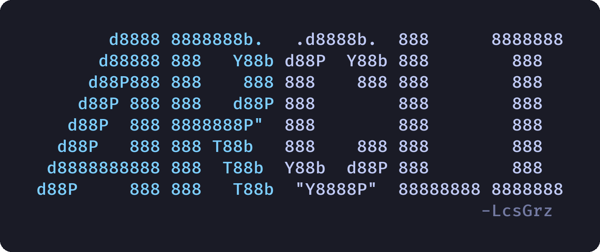

<p align="center">
  
</p>

<p align="center">
  <a href="https://www.npmjs.com/package/arcli"></a>
  <a href="https://www.npmjs.com/package/arcli"></a>
  <a href="https://github.com/LcsGrz/arcli/actions/workflows/ci.yml"></a>
  <a href="https://github.com/LcsGrz/arcli/blob/main/LICENSE"></a>
</p>

<h3 align="center">El CLI de facturación electrónica de ARCA (ex AFIP), desde tu terminal</h3>

Emití facturas, consultá comprobantes y automatizá tu facturación con comandos, un asistente interactivo o tu IA favorita. Nada se emite hasta que lo pedís.

**Gratis. De código abierto. Sin entrar al portal de ARCA.**

<p align="center"><a href="https://arcli.com.ar/">Sitio</a> · <a href="https://arcli.com.ar/empezar/instalar/">Empezar</a> · <a href="https://arcli.com.ar/uso/asistente/">Formas de uso</a> · <a href="https://arcli.com.ar/uso/con-ia/">Con IA</a> · <a href="https://arcli.com.ar/ayuda/novedades/">Novedades</a></p>

<p align="center"></p>

<p align="center"><sub>ARCLI es un proyecto independiente, no es de ARCA. Usa los web services oficiales de ARCA con tu propio certificado.</sub></p>

## Elegí cómo usarlo

| Si querés…                              | Usá                                                          | Así                                           |
| --------------------------------------- | ------------------------------------------------------------ | --------------------------------------------- |
| Que te guíe paso a paso                 | el [asistente](https://arcli.com.ar/uso/asistente/)          | `arcli`                                       |
| Facturar en una línea o desde un script | [comandos](https://arcli.com.ar/uso/comandos/)               | `arcli fc -m 15000 --cs --cfinal`             |
| Pedírselo a tu IA                       | [Claude, ChatGPT, Gemini…](https://arcli.com.ar/uso/con-ia/) | "Facturale $ 15.000 a Juan, consumidor final" |

## Qué facturás

| Si sos…               | Comprobantes                                                |
| --------------------- | ----------------------------------------------------------- |
| Monotributista        | Factura, notas de crédito y débito C, y Recibo C            |
| Responsable inscripto | A y B con sus notas, y Factura de Crédito Electrónica (FCE) |
| Exportador            | Factura de exportación E y sus notas                        |

Cada comprobante tiene su página en [arcli.com.ar](https://arcli.com.ar/comprobantes/cual-me-toca/), con cuál te toca y cómo emitirlo.

## Empezar

1. Instalá Node.js 22.22.1 o superior desde [nodejs.org](https://nodejs.org/es/download) (la versión LTS).
2. Abrí la terminal (en Mac: Cmd+Espacio y escribí "Terminal"; en Windows: menú Inicio y escribí "PowerShell") y pegá `npm install -g arcli`.
3. Pegá `arcli acceso-directo`: deja un ícono de ARCLI en el escritorio.
4. Abrí ARCLI con doble clic en el ícono y seguí la configuración guiada. Desde ahí sacás el certificado de ARCA y emitís tu primera factura de prueba en testing, sin validez fiscal.

<details>
<summary>Que lo instale tu IA (Claude, ChatGPT, Gemini, Copilot…)</summary>

Si tu asistente de IA puede manejar tu computadora, copiale esto: hace los pasos 1 a 3 por vos. Sirve para instalar y para actualizar.

```text
Instalá o actualizá ARCLI en esta computadora. Es un programa para emitir facturas de ARCA: https://www.npmjs.com/package/arcli

1. Revisá si tengo Node.js 22.22.1 o superior (node --version). Si no lo tengo o es más viejo, instalá la versión LTS de https://nodejs.org con el instalador oficial para mi sistema.
2. Instalá o actualizá ARCLI con: npm install -g arcli@latest. Si da un error de permisos, explicame la opción más segura antes de usar sudo o permisos de administrador.
3. Verificá con arcli --version y decime qué versión quedó.
4. Si es la primera vez que lo instalo, creá el ícono en el escritorio con: arcli acceso-directo

Si podés ejecutar comandos, hacelo vos; si no, guiame paso a paso, como a alguien que nunca usó la terminal. No toques certificados, claves ni la configuración de ARCLI, y no emitas comprobantes.
```

</details>

<details>
<summary>Con pnpm, yarn o sin instalar (npx)</summary>

```bash
pnpm add -g arcli
yarn global add arcli   # Yarn 1; Yarn 2 o superior no instala paquetes globales
npx arcli@latest --ayuda   # probarlo sin instalar nada
```

Para actualizar, repetí la instalación con `arcli@latest` (por ejemplo, `npm install -g arcli@latest`); cuando hay una versión nueva, ARCLI te avisa con el comando de tu gestor. Funciona en macOS, Linux y Windows.

Opcional: [autocompletado](https://arcli.com.ar/referencia/comandos-completo/#autocompletado) con Tab en bash, zsh o fish (`arcli completado instalar`) y el [acceso directo](https://arcli.com.ar/referencia/comandos-completo/#acceso-directo) del escritorio (`arcli acceso-directo`).

</details>

## Qué trae

- **Vista previa siempre primero:** nada se emite sin `--emitir` o tu confirmación.
- **Validaciones antes de ir a ARCA,** con el motivo y cómo arreglarlo.
- **Consultas sin emitir:** tus comprobantes, el padrón de un CUIT, la cotización y el estado de ARCA.
- **PDF con el QR de ARCA,** al confirmar la emisión.
- **Lotes y JSON para automatizar,** con una salida `--json` estable.
- **Repetir una factura anterior** desde el asistente.

## Seguridad

- **Arranca en testing,** sin validez fiscal. Producción la elegís vos.
- **Tu certificado y tu clave quedan en tu computadora,** y tus comprobantes solo van a ARCA. Aparte, ARCLI consulta npm y GitHub para avisarte de versiones nuevas, y baja el plugin de PDF solo si lo pedís.
- **Código abierto:** podés revisar todo lo que hace.

## Documentación

Está en [arcli.com.ar](https://arcli.com.ar/), con buscador: [certificados](https://arcli.com.ar/empezar/certificado-testing/), [comprobantes](https://arcli.com.ar/comprobantes/cual-me-toca/), [comandos](https://arcli.com.ar/referencia/comandos/), [configuración](https://arcli.com.ar/referencia/configuracion/), [PDF](https://arcli.com.ar/mas/pdf/) y [problemas frecuentes](https://arcli.com.ar/ayuda/problemas-frecuentes/). Para agentes de IA con acceso a la terminal, [llms.txt](https://arcli.com.ar/llms.txt).

<details>
<summary>Configurar por comandos (servidores)</summary>

Lo más simple es correr `arcli` y seguir la configuración guiada. Sin asistente, por ejemplo en un servidor:

```bash
arcli config establecer cuit 20168598204
arcli config establecer puntoVenta 3
arcli certificado generar --testing     # arma la clave y el pedido (CSR) para subir a ARCA
# en ARCA: subí el CSR, bajá el .crt y autorizalo a facturar (wsfe), ver la guía
arcli certificado importar testing.crt  # carga el certificado que te devuelve ARCA
arcli config revisar
```

Si ya tenés el certificado y la clave, cargalos con `arcli config establecer cert.testing <ruta>` y `key.testing <ruta>`. `arcli config revisar` revisa la config local; `arcli estado` prueba la conexión con ARCA. Los valores se toman en orden `flags > JSON > config > defaults`. Más en [Cómo funciona](https://arcli.com.ar/empezar/como-funciona/) y [Configuración](https://arcli.com.ar/referencia/configuracion/).

<p align="center"></p>

</details>

<details>
<summary>Testing, producción y estabilidad</summary>

Por defecto se usa `testing`, con `cert.testing` y `key.testing`. Para producción configurá `cert.produccion` y `key.produccion` y pasá `--produccion` (o guardá `entorno produccion`). Con la config por defecto, además hace falta `--emitir` o confirmar. Ver [Cambiar de entorno](https://arcli.com.ar/empezar/entornos/).

ARCLI usa [versionado semántico](https://semver.org/lang/es/): los comandos y sus flags, las claves de configuración y el JSON de entrada (`--cargar`) y salida (`--json`), con sus `codigo` de error, solo cambian de forma incompatible en una versión mayor, avisado en el [CHANGELOG](https://github.com/LcsGrz/arcli/blob/main/CHANGELOG.md). La salida en texto puede cambiar en cualquier versión: para scripts, usá `--json`.

</details>

## Comunidad

- **Dudas de uso:** [GitHub Discussions](https://github.com/LcsGrz/arcli/discussions).
- **Bugs y propuestas:** [issues](https://github.com/LcsGrz/arcli/issues/new/choose), con las plantillas.
- **Vulnerabilidades:** en privado, como dice [SECURITY.md](https://github.com/LcsGrz/arcli/blob/main/SECURITY.md).
- **Colaborar:** [CONTRIBUTING.md](https://github.com/LcsGrz/arcli/blob/main/CONTRIBUTING.md).

No pegues certificados, claves, tickets ni la salida de `--bruto` en ningún lado. Si te sirve, dejale una estrella o invitame un [Cafecito](https://cafecito.app/lcsgrz).

## Agradecimientos

- [`@arcasdk/core`](https://github.com/ralcorta/arcasdk) y [`@arcasdk/pdf`](https://www.afipts.com/packages/pdf), de [Rodrigo Alcorta](https://github.com/ralcorta).
- [Arpit Bhayani](https://github.com/arpitbbhayani), por ceder el nombre `arcli` en npm.
- [Manuel Aller](https://github.com/itManuel), por la factura de exportación E.
- [Guillermo Britos](https://github.com/guillermobr), por el Recibo C.
- [Kevin Tea](https://github.com/kevintea), por la condición de venta en el PDF.

## Licencia

MIT © [LcsGrz](https://github.com/LcsGrz). Ver [LICENSE](https://github.com/LcsGrz/arcli/blob/main/LICENSE).
