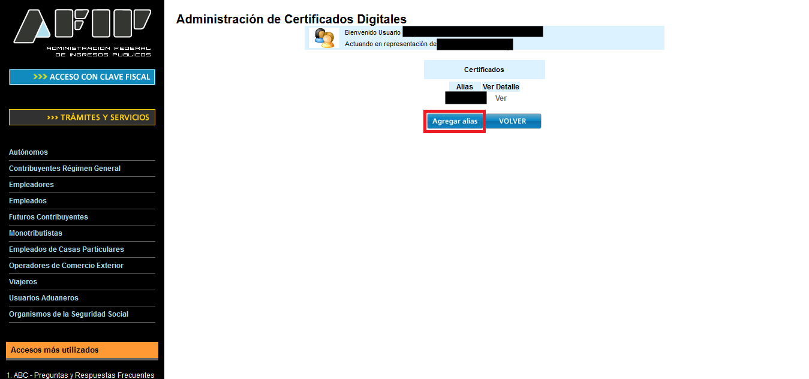
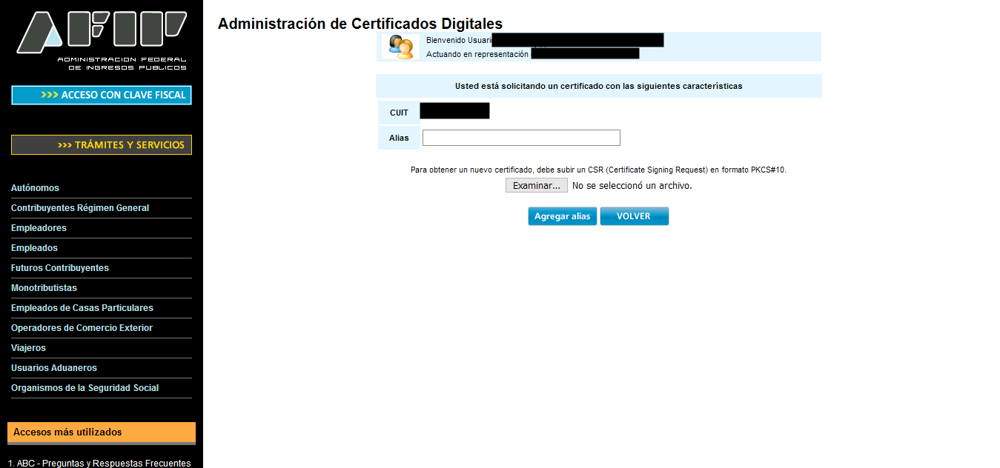
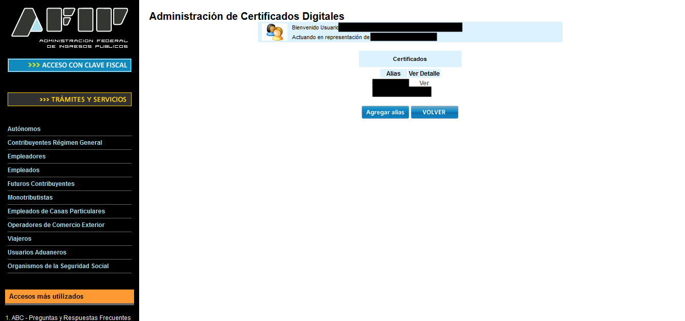
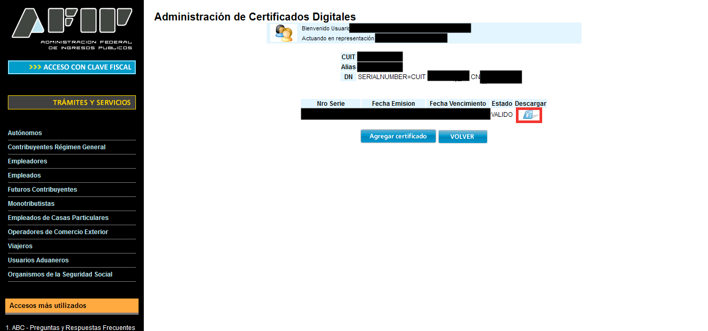
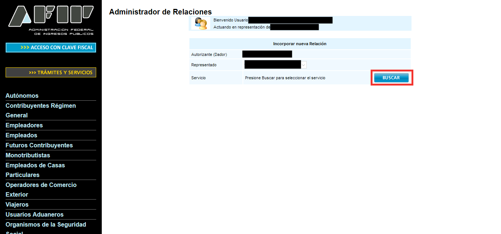
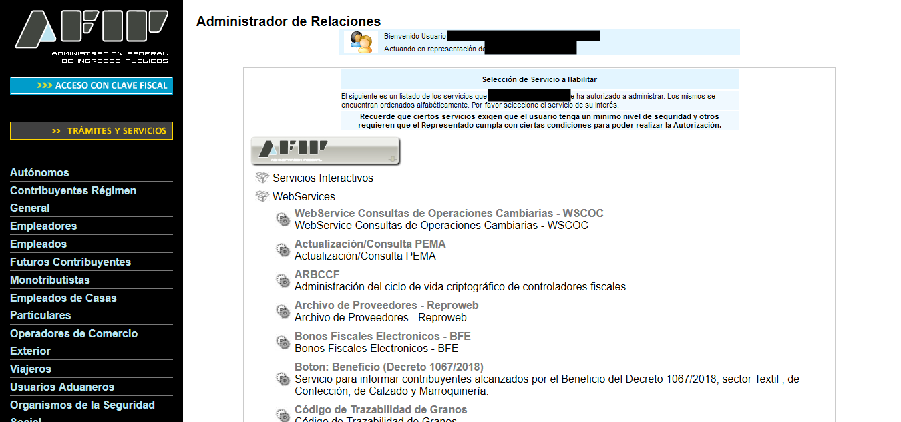
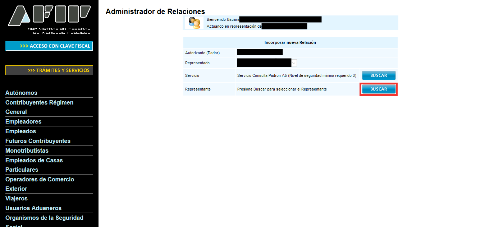
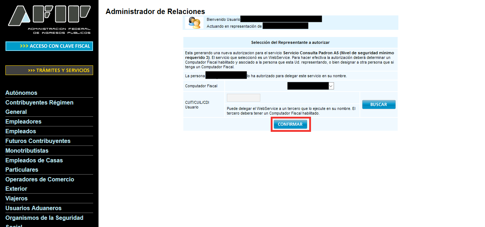
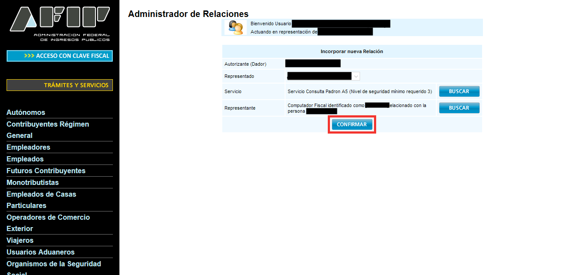

[← Documentación](README.md)

# Certificado de producción

Para emitir comprobantes con validez fiscal necesitás un certificado de **producción**, distinto del de testing, y un punto de venta para web service. Si todavía no probaste en testing, empezá por el [certificado de testing](certificado-testing.md): los pasos son casi los mismos.

> Contenido adaptado de los tutoriales de [afipts.com](https://www.afipts.com) (ver
> [fuentes](#fuentes) al final). Las capturas son de ese sitio; los pasos y comandos
> están reescritos y verificados para esta guía.

Repetí el mismo flujo del [certificado de testing](certificado-testing.md), con dos diferencias: la aplicación para generar el certificado no
es WSASS sino **"Administración de Certificados Digitales"**, y la autorización del
servicio web se hace desde el Administrador de Relaciones en vez de WSASS.

## 1. Habilitar el administrador de certificados

Son los mismos 5 pasos que en el [certificado de testing](certificado-testing.md#1-habilitar-el-administrador-de-certificados), eligiendo el mismo servicio
**Administración de Certificados Digitales** para tu usuario en producción.

## 2. Generar la clave y obtener el certificado

**Con ARCLI (recomendado).** Generá el pedido:

```bash
arcli certificado generar --produccion
```

Subí el CSR como se muestra abajo y, con el `.crt` descargado, cargalo:

```bash
arcli certificado importar produccion.crt
```

Configura `cert.produccion` y `key.produccion`, así que en el paso 4 solo queda revisar.

**Para renovar** un certificado que está por vencer, es el mismo flujo: `generar` deja la clave nueva
pendiente y no toca la actual, así que seguís facturando hasta que `importar` carga el certificado nuevo.
Acordate de volver a crear las relaciones del paso 3 si usás un alias nuevo.

**Con openssl.** Mismos comandos que en testing, con un archivo distinto:

```bash
openssl genrsa -out produccion.key 2048
openssl req -new -key produccion.key -subj "/C=AR/O=[empresa]/CN=[nombre]/serialNumber=CUIT [CUIT]" -out produccion.csr
```

Entrá a **"Administración de Certificados Digitales"** desde el escritorio de ARCA y
elegí **"Agregar alias"**:



Completá el **Alias** y subí el CSR con **"Examinar..."**: con ARCLI, el archivo que te indicó `generar`;
con openssl, `produccion.csr`:



Confirmá con **"Agregar Alias"**. En la lista de certificados, hacé clic en **"Ver"** para
tu alias:



Y descargá el certificado desde el ícono de descarga (columna **Descargar**, estado
`VALIDO`):



El CSR ya no es necesario después de este paso, podés borrarlo.

## 3. Autorizar el servicio web

En producción esto se hace desde el **Administrador de Relaciones**, no desde WSASS.
Elegí **"Nueva Relación"** y presioná **"Buscar"** junto a Servicio:



Navegá a **ARCA → Web Services** y elegí el servicio que necesitás (ej. `wsfe`). Creá una relación por cada servicio de [Qué servicios autorizar](certificado-testing.md#qué-servicios-autorizar) que vayas a usar:



Presioná **"Buscar"** junto a Representante:



Elegí el **Computador Fiscal** asociado a tu certificado y confirmá:



Por último, confirmá la relación completa:



## 4. Configurar ARCLI

Hay dos formas, según cómo generaste la clave en el paso 2:

- **Con `arcli certificado` (recomendada):** si usaste `generar` e `importar`, ya está: `importar` guardó el certificado junto a la clave y configuró `cert.produccion` y `key.produccion`. Solo falta revisar.
- **Con openssl:** cargá a mano las rutas del certificado y de la clave:

  ```bash
  arcli config establecer cert.produccion /ruta/a/produccion.crt
  arcli config establecer key.produccion /ruta/a/produccion.key
  ```

En los dos casos, revisá la config y probá la conexión con ARCA:

```bash
arcli config revisar
arcli estado --produccion
```

Para emitir de verdad en producción, pasá además `--produccion --emitir` en el
comando de facturación: ver [cambiar de entorno](entornos.md).

## Punto de venta para web service

Para emitir en producción también necesitás un punto de venta dado de alta para **web
service**. No sirve cualquiera: ARCA rechaza el comprobante (error `10005`, "El punto de
venta informado debe estar dado de alta y ser del tipo RECE") si el número que configurás
en ARCLI es de otro sistema, como los de **Comprobantes en línea** ("Factura en línea"),
Facturador o talonarios manuales. Cada sistema usa sus propios puntos de venta: si ya
facturás desde la web de ARCA, creá uno nuevo para ARCLI.

> **Monotributistas, desde el 1/11/2026:** con la
> [RG 5893/2026](https://www.boletinoficial.gob.ar/detalleAviso/primera/346598/20260831),
> si no tenés un punto de venta electrónico habilitado, ARCA te da de alta uno de oficio
> para **Comprobantes en línea**, con la opción "Factura en línea - Monotributo". Ese
> punto de venta no sirve para ARCLI: creá otro para web service.

En testing no hace falta: ARCA no controla el punto de venta y cualquier número sirve.

> En producción, la factura de exportación (`arcli fe`) usa **WSFEX - Factura Electrónica de Exportación**, que es un sistema de puntos de venta distinto del de facturación (`wsfe`): un punto de venta habilitado solo para facturación electrónica no sirve para exportación. Dalo de alta con ese sistema si vas a emitir comprobantes `E`.

### 1. Ver si ya tenés uno

Con el certificado de producción configurado:

```bash
arcli parametros puntos-venta --produccion
```

La lista trae solo los puntos de venta de web service (CAE o CAEA); los bloqueados o dados de baja salen marcados. Si el
tuyo no aparece, o la lista está vacía, seguí con el paso 2. `arcli estado --produccion`
también avisa si el punto de venta configurado no está entre los habilitados.

### 2. Crearlo en ARCA

1. Entrá al portal de ARCA con tu Clave Fiscal y abrí el servicio **"Administración de
   puntos de venta y domicilios"**. Si no lo ves, adherilo desde el Administrador de
   Relaciones, como hiciste con el de certificados.
2. Elegí tu CUIT y entrá a **"A/B/M de puntos de venta"**.
3. Presioná **"Agregar"** (o "Alta") y completá:
   - **Número:** uno que no uses en ningún otro sistema (por ejemplo `2` si el `1` es de
     Comprobantes en línea).
   - **Sistema:** el de web services que corresponde a tu condición. Según la tabla de
     ARCA, **"Factura Electrónica - Monotributo - Webservices"** si sos monotributista, o
     **"Factura Electrónica - RI IVA - Aplicativo y Webservices"** si sos responsable
     inscripto. En algunas pantallas aparece como "RECE para aplicativo y web services".
     No elijas una opción que diga "Comprobantes en Línea" ni "Factuweb".
   - **Domicilio:** el domicilio desde el que facturás.
4. Confirmá.

Después, revisá que aparezca y guardalo en ARCLI:

```bash
arcli parametros puntos-venta --produccion
arcli config establecer puntoVenta 2
arcli estado --produccion
```

## Renovar el certificado

### Cuándo usarlo

Cuando `arcli config revisar` o el aviso de cada comando dicen que el certificado vence pronto, o para sacar el primero.

### Comando

```bash
arcli certificado generar --produccion
# en ARCA: subís el CSR que muestra y bajás el .crt
arcli certificado importar produccion.crt
```

### Resultado esperado

- hasta importar seguís facturando con el certificado actual: `generar` no toca la clave activa
- `importar` dice qué cargó (entorno, CUIT, alias y vencimiento) y deja el par anterior como `.anterior.*`

### Errores comunes

- importar el `.crt` de otro CSR (`CERTIFICATE_KEY_MISMATCH`): usá el del último `generar`
- olvidar autorizar los servicios web si cambiaste de alias

## Siguiente paso

Revisá todo con el checklist de [cambiar de entorno](entornos.md#antes-de-la-primera-factura-real) antes de emitir la primera factura real.

---

## Fuentes

Tutoriales originales de afipts.com en los que se basa esta guía:

- [Habilitar administrador de certificados de producción](https://www.afipts.com/tutorial/enable-production-certificate-manager.html)
- [Obtener certificado de producción](https://www.afipts.com/tutorial/obtain-production-certificate.html)
- [Autorizar servicio web de producción](https://www.afipts.com/tutorial/authorize-web-production-service.html)

Punto de venta para web service:

- [Puntos de venta: para qué se utiliza cada sistema](https://www.afip.gob.ar/facturacion/documentos/puntos-de-venta.pdf) (ARCA)
- [Acciones a realizar para consumir un web service de factura electrónica](https://www.afip.gob.ar/fe/documentos/AccionesarealizarparaconsumirunWebservicedeFacturaElectr.pdf) (ARCA)
- [Manual del desarrollador de WSFEv1](https://www.afip.gob.ar/ws/documentacion/manuales/manual-desarrollador-ARCA-COMPG.pdf) (ARCA, error `10005` y `FEParamGetPtosVenta`)
- [RG 5893/2026](https://www.boletinoficial.gob.ar/detalleAviso/primera/346598/20260831) (Boletín Oficial)
