[← Volver a la documentación](README.md)

# Certificado de producción

Para facturar con validez fiscal. Son los mismos pasos que en testing; cambian el lugar donde se baja el certificado y cómo se autoriza. Tardás unos 20 minutos y necesitás tu clave fiscal nivel 3.

> [!TIP]
> **También desde el asistente:** abrí ARCLI → Configuración → Certificados de ARCA → Sacar o renovar un certificado → Producción. Te va diciendo qué hacer en ARCA.

## Pasos

<!-- arcli: pasos -->

### 1. Habilitá el administrador de certificados

Una sola vez: si ya lo hiciste para testing, salteá este paso. Si no, con tu clave fiscal, en el **Administrador de Relaciones de Clave Fiscal**: Adherir Servicio → ARCA → Servicios Interactivos → **Administración de Certificados Digitales**, y confirmá.

<details>
<summary>Ver capturas (5)</summary>

1. Buscá el Administrador de Relaciones de Clave Fiscal
   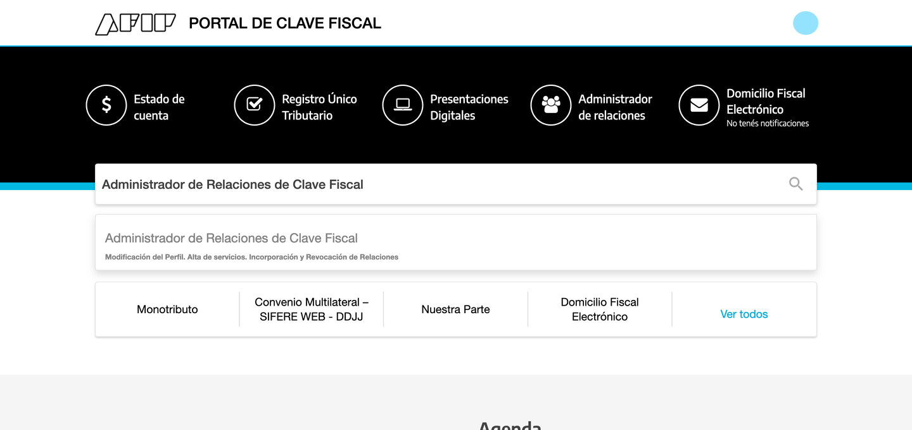
2. Elegí el contribuyente
   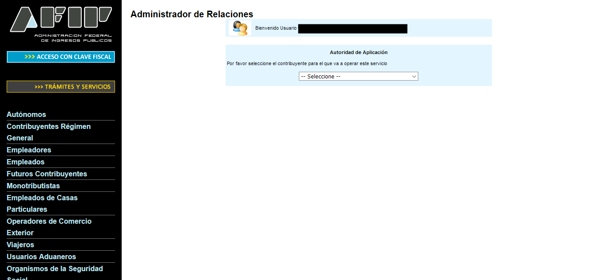
3. Tocá "Adherir Servicio"
   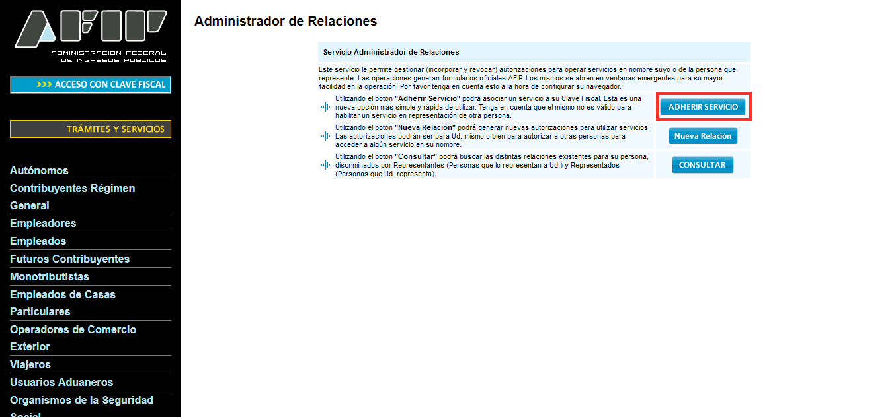
4. Elegí Administración de Certificados Digitales
   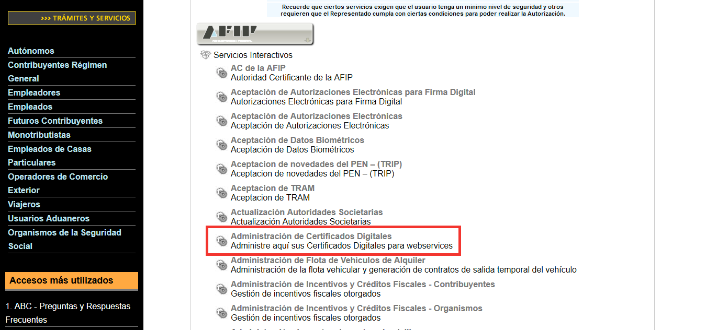
5. Confirmá la relación
   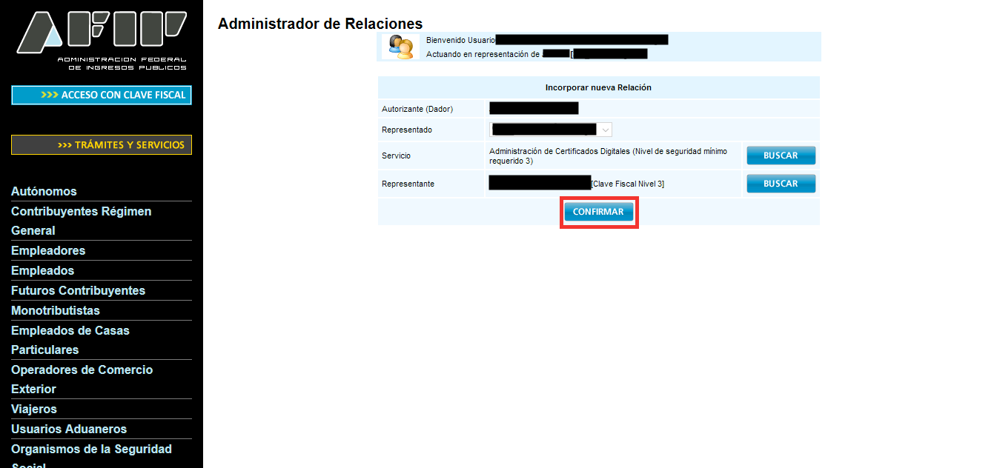

</details>

### 2. Generá el pedido con ARCLI

```bash
arcli certificado generar --produccion
```

Te dice dónde quedó el pedido (el CSR). La clave privada queda guardada en tu computadora.

### 3. Subilo en Administración de Certificados Digitales y bajá el certificado

Entrá desde el escritorio de ARCA y elegí **Agregar alias**. Poné un alias, subí el CSR con **Examinar…** y confirmá. En la lista, tocá **Ver** en tu alias y descargá el certificado. Después cargalo:

```bash
arcli certificado importar produccion.crt
```

<details>
<summary>Ver capturas (4)</summary>

1. Agregar alias
   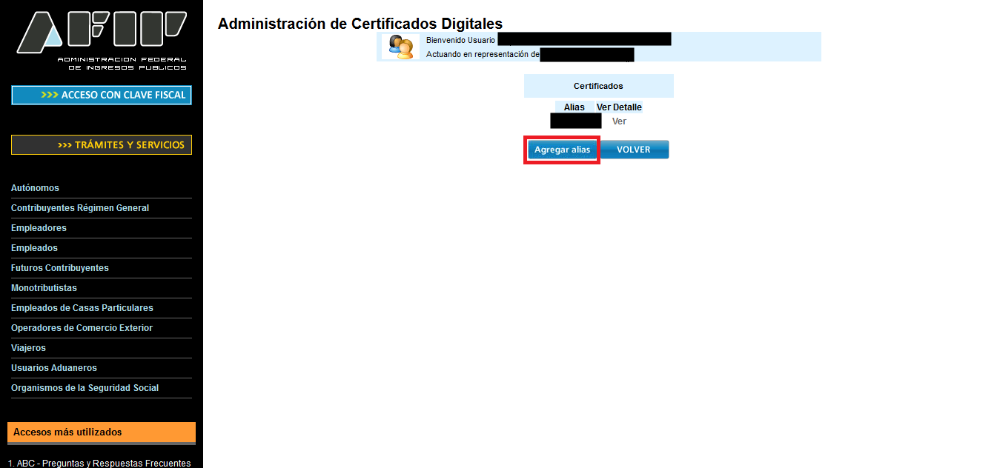
2. El alias y el CSR para subir
   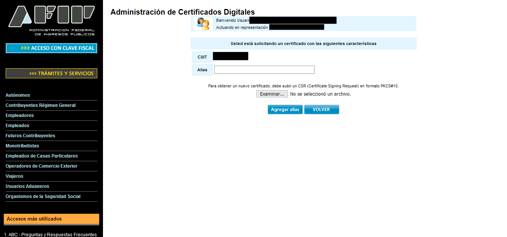
3. Ver el certificado en la lista
   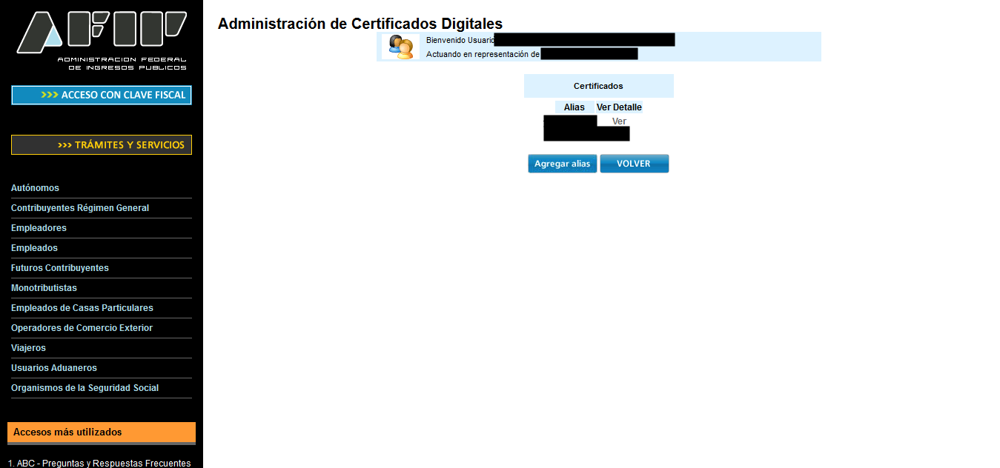
4. Descargarlo (estado VALIDO)
   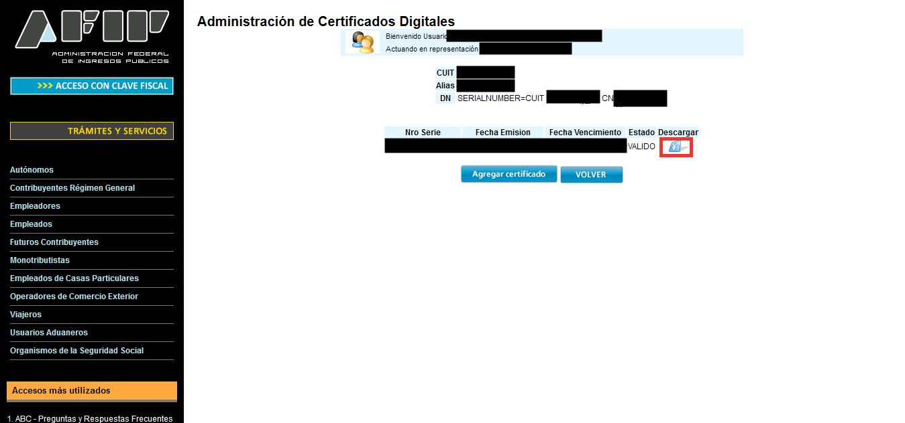

</details>

### 4. Autorizalo a los servicios que vas a usar

En producción no se hace en WSASS sino en el **Administrador de Relaciones**: **Nueva Relación** → Buscar servicio → ARCA → Web Services → el servicio. En Representante, elegí el **Computador Fiscal** de tu certificado y confirmá. Una relación por cada servicio de [esta tabla](certificado-testing.md#qué-servicios-autorizar) que necesites.

<details>
<summary>Ver capturas (5)</summary>

1. Nueva Relación: buscar el servicio
   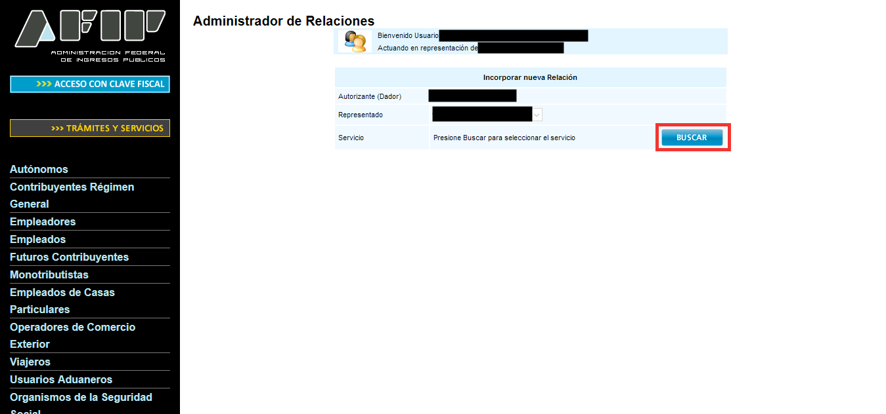
2. Elegir el web service
   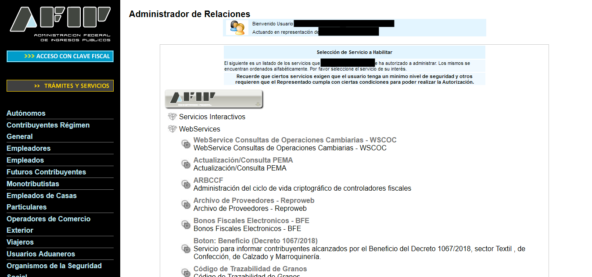
3. Buscar el representante
   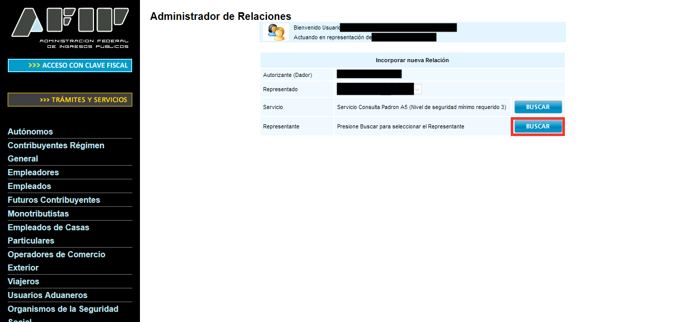
4. Elegir el Computador Fiscal
   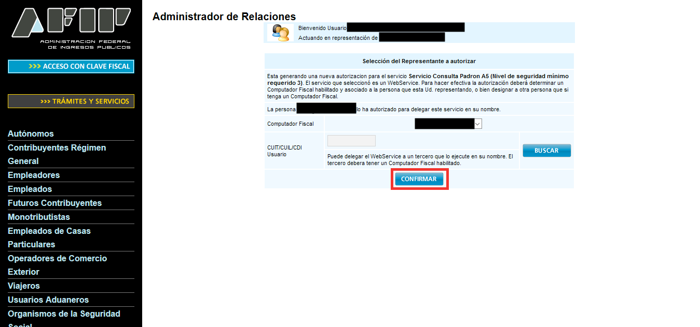
5. Confirmar la relación
   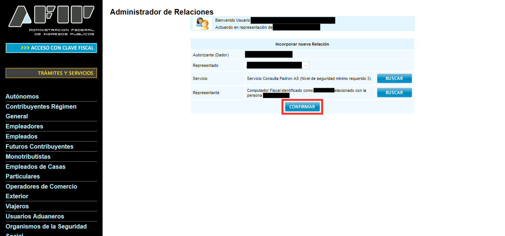

</details>

### 5. Creá un punto de venta para web service

Fijate si ya tenés uno:

```bash
arcli parametros puntos-venta --produccion
```

Si la lista está vacía, crealo en **Administración de puntos de venta y domicilios** → A/B/M de puntos de venta → Agregar. En Sistema elegí **Factura Electrónica - Monotributo - Webservices** o, si sos responsable inscripto, **RI IVA - Aplicativo y Webservices**. Después guardalo:

```bash
arcli config establecer puntoVenta 2
```

> [!WARNING]
> **El de Factura en línea no sirve.** Cada sistema usa sus propios puntos de venta: con uno de Comprobantes en línea, ARCA rechaza con el error `10005`. La Factura E necesita además uno del sistema WSFEX, que se crea igual; `arcli parametros puntos-venta` no sirve para revisarlo: consulta los de A, B y C.

## Revisar que quedó bien

```bash
arcli estado --produccion
```

Si dice que ARCA responde y el punto de venta está habilitado, ya podés emitir con validez fiscal.

## Renovar el certificado

Es el mismo camino: `generar` deja la clave nueva aparte y seguís facturando con la actual hasta que `importar` carga el certificado nuevo. Si usás un alias nuevo, repetí el paso 4.

## ¿Preferís openssl?

Los comandos para generar la clave a mano, el detalle del punto de venta y las fuentes están en la [versión completa de esta guía](certificado-produccion-completa.md).

## Siguiente paso

Antes de la primera factura real, repasá [cambiar de entorno](entornos.md).
