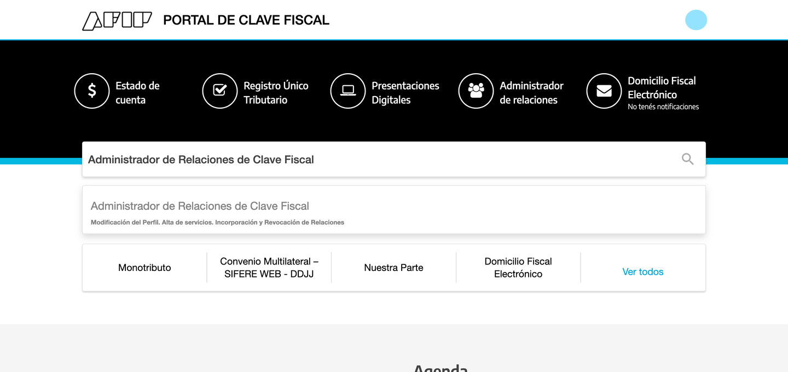
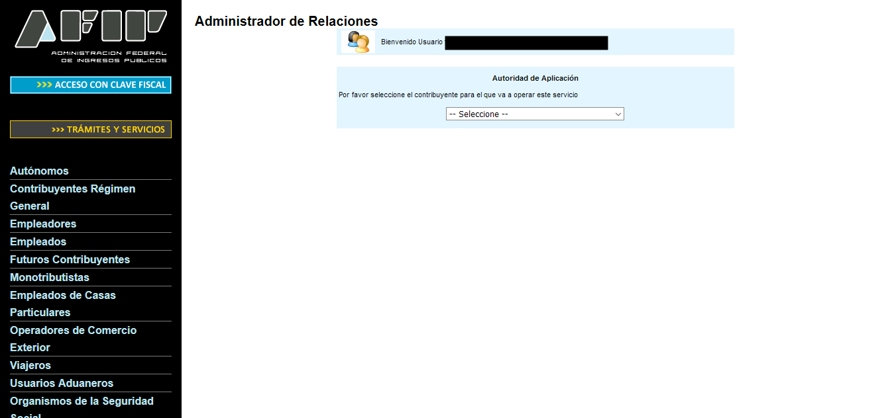
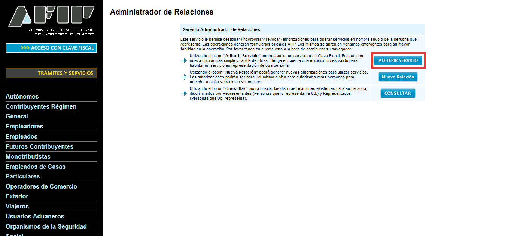
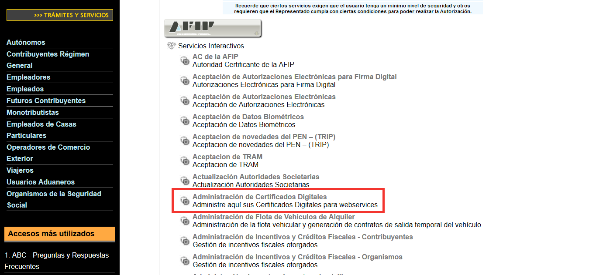
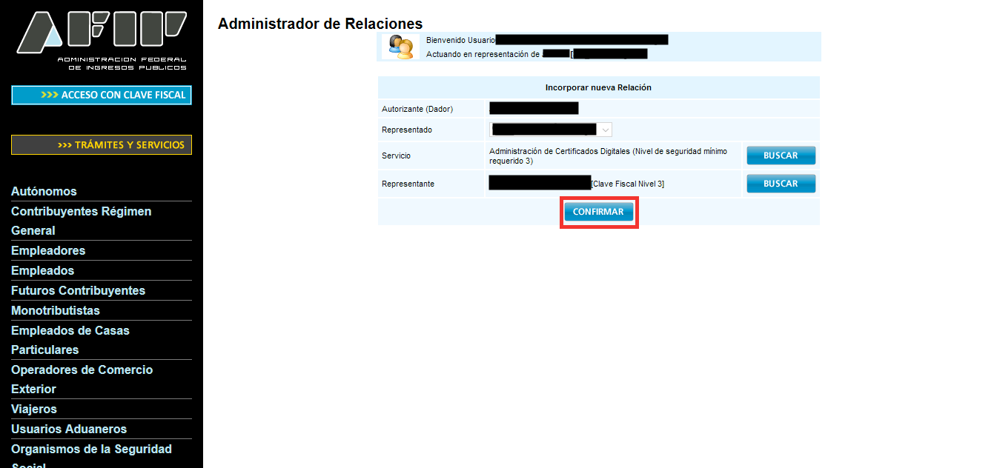
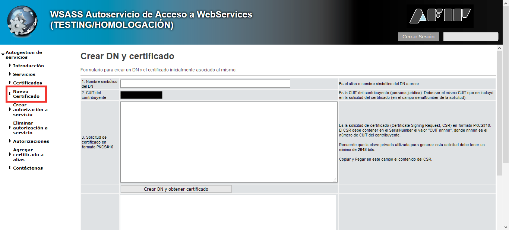
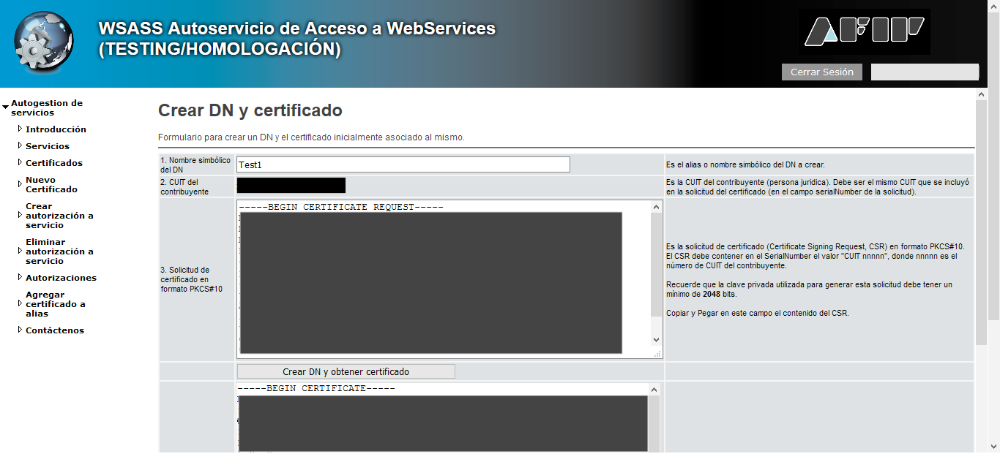
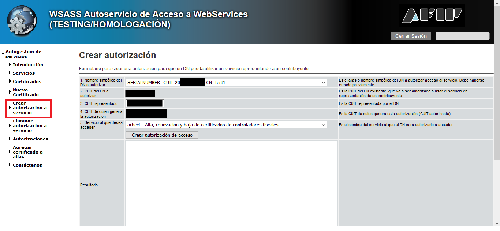
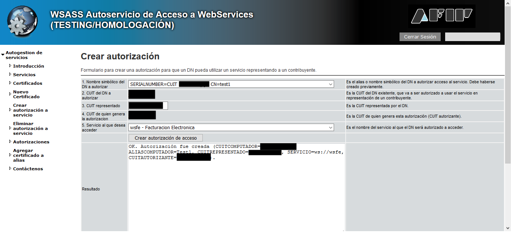
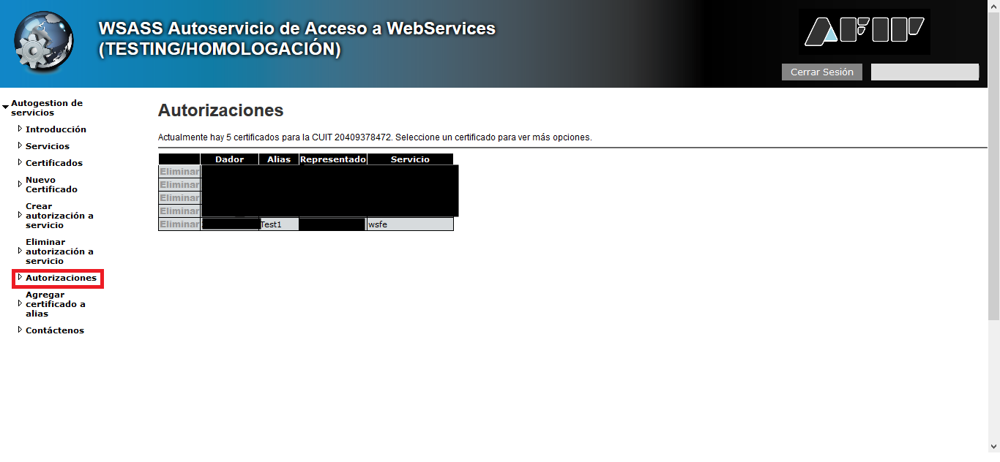

[← Volver a la documentación](README.md)

# Certificado de testing

Para probar ARCLI sin validez fiscal. Son 4 pasos y tardás unos 15 minutos. Necesitás tu clave fiscal nivel 3.

> [!TIP]
> **También desde el asistente:** abrí ARCLI → Configuración → Certificados de ARCA y seguí los pasos. Te va diciendo qué hacer en ARCA.

## Pasos

<!-- arcli: pasos -->

### 1. Habilitá el administrador de certificados

Una sola vez. Con tu clave fiscal, en el **Administrador de Relaciones de Clave Fiscal**: Adherir Servicio → ARCA → Servicios Interactivos → **Administración de Certificados Digitales**, y confirmá.

<details>
<summary>Ver capturas (5)</summary>

1. Buscá el Administrador de Relaciones de Clave Fiscal
   
2. Elegí el contribuyente: en pruebas, vos
   
3. Tocá "Adherir Servicio"
   
4. Elegí Administración de Certificados Digitales
   
5. Confirmá la relación
   

</details>

### 2. Generá el pedido con ARCLI

```bash
arcli certificado generar --testing
```

Te muestra un texto (el CSR) para copiar. La clave privada queda guardada en tu computadora.

### 3. Pegalo en WSASS y bajá el certificado

Entrá a **WSASS - Autoservicio de Acceso a WebServices** desde el escritorio de ARCA. En "Nuevo Certificado", pegá el CSR, creá el certificado y guardalo en un archivo. Después cargalo:

```bash
arcli certificado importar testing.crt
```

<details>
<summary>Ver capturas (2)</summary>

1. Formulario "Crear DN y certificado"
   
2. CSR pegado y certificado generado
   

</details>

### 4. Autorizalo a los servicios que vas a usar

En WSASS, "Crear autorización a servicio": elegí tu certificado y un servicio. Repetilo por cada servicio de [la tabla](#qué-servicios-autorizar) que necesites.

<details>
<summary>Ver capturas (3)</summary>

1. Formulario "Crear autorización"
   
2. Autorización creada para wsfe
   
3. La lista de autorizaciones con la nueva
   

</details>

Para revisar que quedó todo bien:

```bash
arcli estado --testing
```

Si dice que ARCA responde, ya podés emitir en testing. Un servicio que falte se suma después, repitiendo solo este paso.

## Qué servicios autorizar

| Para                                                 | Servicio                       | ¿Lo necesitás? |
| ---------------------------------------------------- | ------------------------------ | -------------- |
| Facturas y notas A, B y C, y FCE                     | `wsfe`                         | Sí, siempre    |
| El IVA del receptor desde el padrón y `arcli padron` | `ws_sr_constancia_inscripcion` | Recomendado    |
| Saber si el receptor está obligado a FCE             | `wsfecred`                     | Si emitís FCE  |
| Factura de exportación E y sus notas                 | `wsfex`                        | Si exportás    |

## ¿Preferís openssl?

Si generás la clave a mano en vez de usar `arcli certificado`, los comandos están en la [versión completa de esta guía](certificado-testing-completa.md), con cada pantalla de ARCA.

## Siguiente paso

Emití tu primera factura en testing desde el [asistente](formas-de-uso/asistente.md). Cuando quieras facturar de verdad, seguí con el [certificado de producción](certificado-produccion.md).
