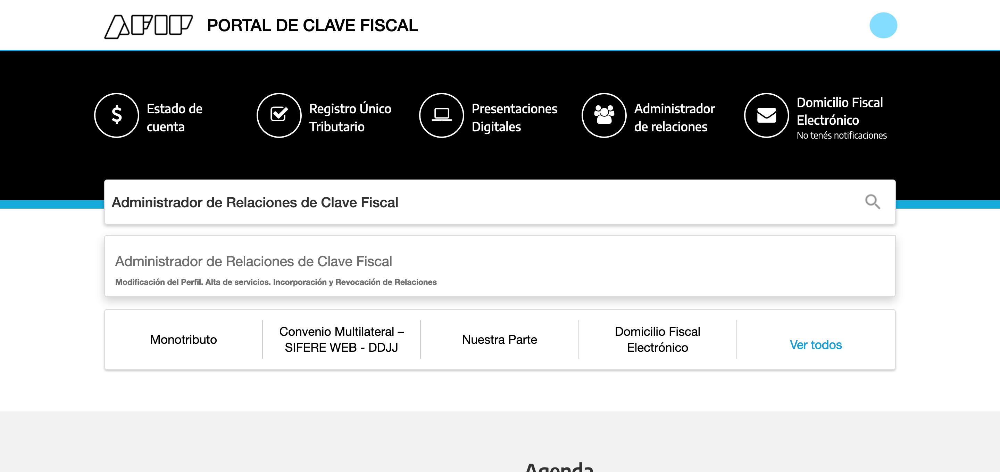
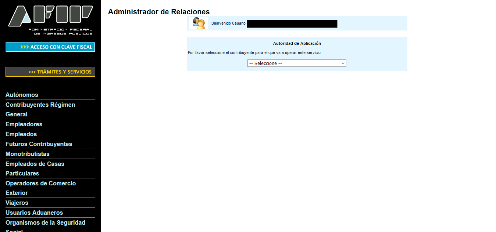
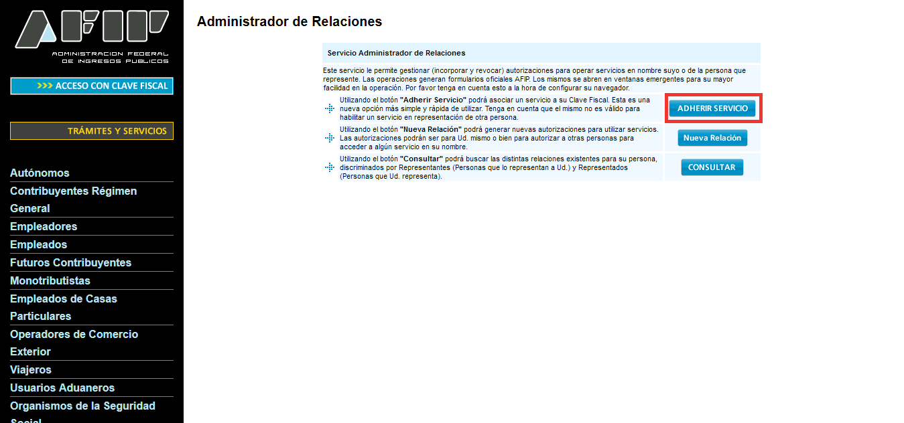
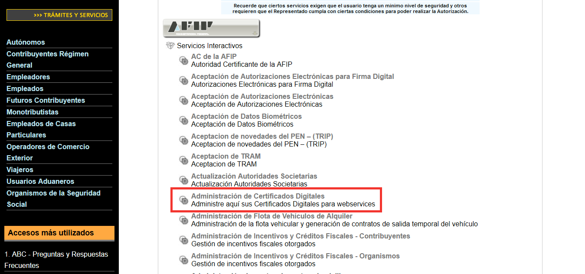
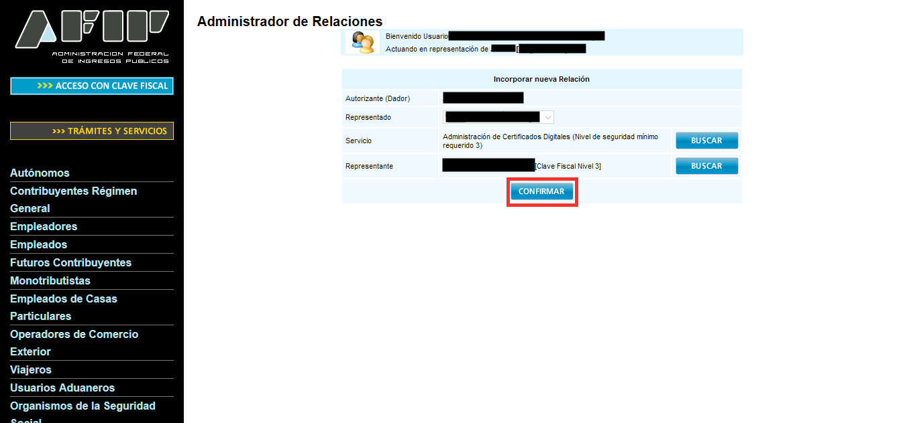
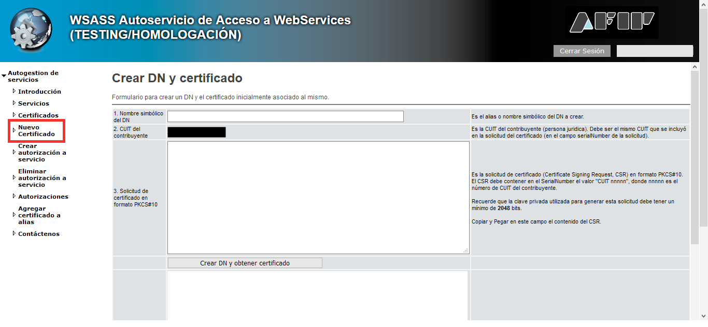
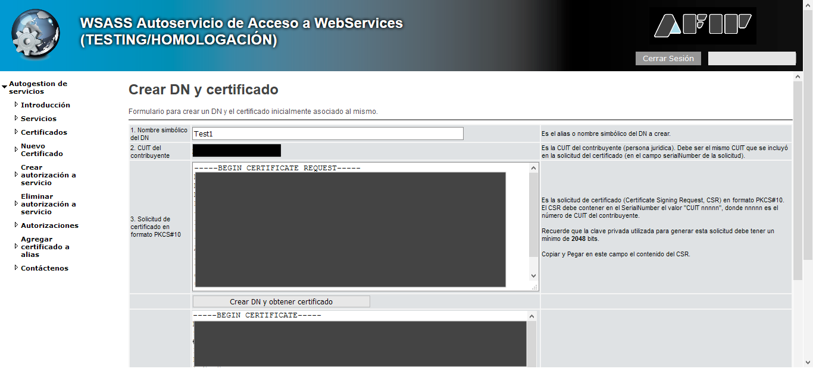
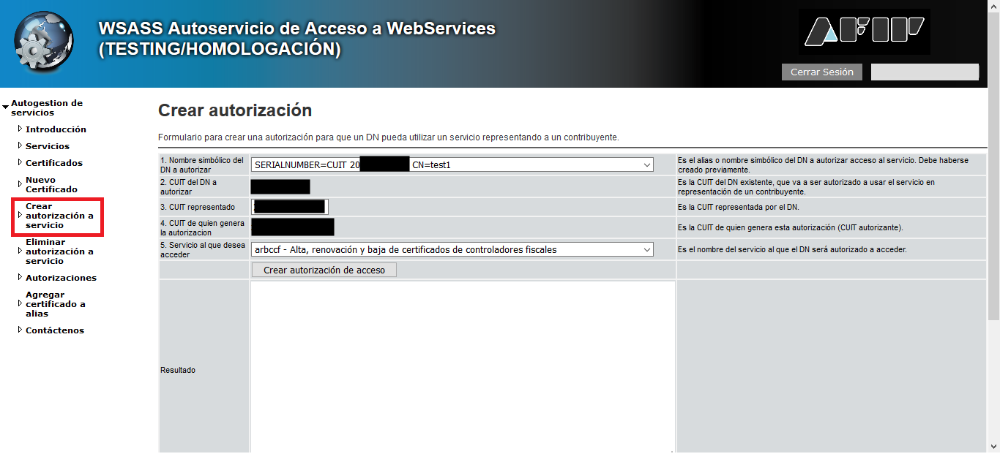
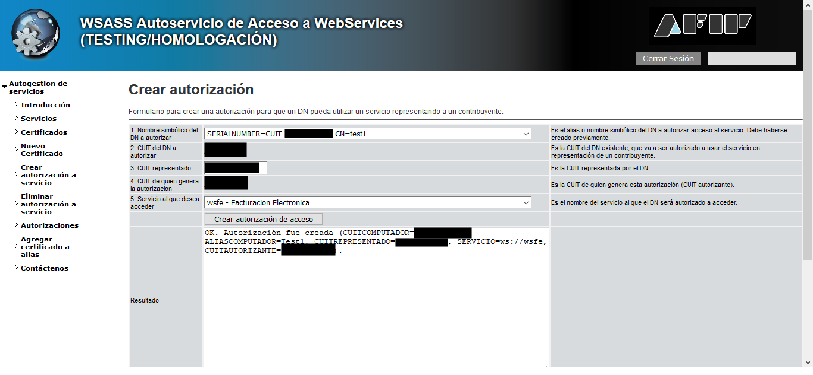
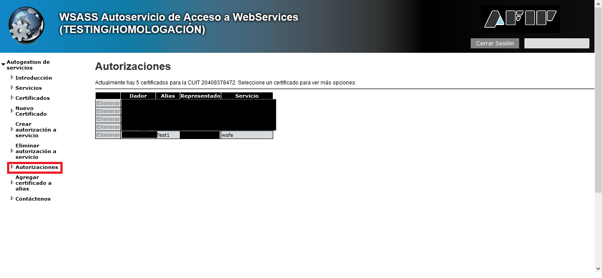

[← Documentación](README.md)

# Certificado de testing

Para probar arcli sin validez fiscal necesitás un certificado de **testing** (homologación) y su clave privada. Esta guía muestra cada pantalla del portal de ARCA. Cuando quieras facturar de verdad, seguí con el [certificado de producción](certificado-produccion.md).

**En resumen**, en la web de ARCA vas a habilitar el servicio, crear el certificado con el pedido que arma arcli y autorizarlo a facturar (`wsfe`). Desde arcli se hace con `arcli certificado generar` e `importar`, o en el asistente: Configuración → Certificados de ARCA.

> Contenido adaptado de los tutoriales de [afipts.com](https://www.afipts.com) (ver
> [fuentes](#fuentes) al final). Las capturas son de ese sitio; los pasos y comandos
> están reescritos y verificados para esta guía.

## Antes de empezar

- Necesitás tu Clave Fiscal (nivel de seguridad 3) para entrar al portal de ARCA.
- Solo si generás la clave a mano en vez de usar `arcli certificado`, necesitás `openssl`. En Linux y macOS ya viene instalado; en Windows lo bajás de
  [slproweb.com/products/Win32OpenSSL.html](https://slproweb.com/products/Win32OpenSSL.html)
  y agregás la carpeta `bin` a tu `PATH` (o abrís la consola directamente desde ahí).
- El flujo de **habilitar el administrador de certificados** es idéntico en testing y en
  producción — lo único que cambia es a qué aplicación te lleva al final. Si ya lo hiciste
  para un entorno, repetís los mismos pasos eligiendo el otro servicio.

### Qué servicios autorizar

El certificado no alcanza: en el paso 3 lo autorizás a cada servicio web que vayas a
usar, y algunos comandos usan uno distinto de `wsfe`. Si falta la autorización, ARCA
rechaza el pedido aunque el certificado sea válido. Autorizá desde el principio lo que
vayas a necesitar:

| Para usar                                               | Servicio que autorizás                                     | Punto de venta en producción                                                               |
| ------------------------------------------------------- | ---------------------------------------------------------- | ------------------------------------------------------------------------------------------ |
| Facturas y notas `A`, `B`, `C` y FCE                    | `wsfe` (Facturación Electrónica)                           | uno de web service ([ver cómo](certificado-produccion.md#punto-de-venta-para-web-service)) |
| `arcli padron` y el IVA del receptor desde el padrón    | `ws_sr_constancia_inscripcion` (Constancia de inscripción) | no usa                                                                                     |
| `arcli fce-obligado` y el aviso de FCE (`verificarFce`) | `wsfecred` (Factura de Crédito Electrónica MiPyMEs)        | no usa                                                                                     |
| `arcli fe`, la factura de exportación `E`               | `wsfex` (Factura Electrónica de Exportación)               | uno del sistema WSFEX, distinto del de `wsfe`                                              |

Se puede sumar un servicio después, repitiendo solo el paso 3 con el mismo certificado.

---

## 1. Habilitar el administrador de certificados

1. Entrá al portal de ARCA con tu Clave Fiscal y buscá **"Administrador de Relaciones de
   Clave Fiscal"**.

   

2. Elegí el contribuyente a administrar. En pruebas, usá tu propio usuario para no
   confundirte con datos de otra persona.

   

3. Elegí **"Adherir Servicio"**.

   

4. Buscá **ARCA → Servicios Interactivos → Administración de Certificados Digitales** en
   la lista y seleccionalo.

   

5. Confirmá la relación.

   

## 2. Generar la clave y el certificado

**Con arcli (recomendado).** Desde el modo interactivo: `arcli` → Configuración → Certificados de ARCA. O por comandos, con el CUIT ya configurado (`arcli config establecer cuit <CUIT>`):

```bash
arcli certificado generar --testing
```

Crea la clave privada y el CSR en la carpeta de config de arcli (no necesitás `openssl`, tampoco en
Windows) y te muestra el CSR para pegar en WSASS. Seguí con "Ahora entrá a WSASS" más abajo y, cuando
tengas el certificado en un archivo, cargalo:

```bash
arcli certificado importar testing.crt
```

`importar` valida el certificado, lo guarda junto a la clave y configura `cert.testing` y `key.testing`:
en el paso 4 solo queda revisar. Te dice qué cargó (entorno, CUIT, alias y vencimiento).

**Con openssl.** Generá la clave privada (2048 bits como mínimo) y guardala en un lugar seguro — es la
"contraseña" del certificado, si la perdés tenés que empezar de nuevo:

```bash
openssl genrsa -out testing.key 2048
```

Con esa clave, generá el CSR (Certificate Signing Request). Reemplazá `[empresa]`,
`[nombre]` y `[CUIT]` por tus datos (en pruebas, podés usar los tuyos):

```bash
openssl req -new -key testing.key -subj "/C=AR/O=[empresa]/CN=[nombre]/serialNumber=CUIT [CUIT]" -out testing.csr
```

Ahora entrá a **WSASS - Autoservicio de Acceso a WebServices (Testing/Homologación)**
desde el escritorio de ARCA (llegaste ahí en el paso anterior) y elegí **"Nuevo
Certificado"**:



Completá:

1. **Nombre simbólico del DN**: un alias para identificar este certificado. Con `arcli certificado generar` es el alias que muestra (por defecto `arcli`); con openssl, el que hayas puesto (ej. `Test1`).
2. **CUIT del contribuyente**: ya viene completo.
3. **Solicitud de certificado**: pegá el CSR que te mostró `arcli certificado generar` o, con
   openssl, el contenido completo de `testing.csr` (abrilo con un editor de texto).

Presioná **"Crear DN y obtener certificado"** y copiá el certificado que aparece en el
recuadro de resultado a un archivo (ej. `testing.crt`):



Con arcli, importalo como se explicó arriba. Con openssl, ya no necesitás el CSR y podés borrarlo:
guardá `testing.key` y `testing.crt`, que son los que vas a usar en arcli.

## 3. Autorizar el servicio web

El certificado por sí solo no alcanza: hay que autorizarlo explícitamente a usar el
servicio web que te interesa (por ejemplo `wsfe`, facturación electrónica). Dentro de
WSASS, elegí **"Crear autorización a servicio"**:



Completá:

1. **Nombre simbólico del DN a autorizar**: el alias que creaste antes (por defecto `arcli`).
2. **CUIT representado**: en pruebas, tu propio CUIT.
3. **Servicio al que deseas acceder**: `wsfe` para facturación electrónica.

> Repetí este paso con cada servicio de [Qué servicios autorizar](#qué-servicios-autorizar) que vayas a usar: `ws_sr_constancia_inscripcion`, `wsfecred` o `wsfex`.

Presioná **"Crear autorización de acceso"** — deberías ver un mensaje `OK. Autorización
fue creada`:



Podés verificarlo entrando a la sección **"Autorizaciones"**:



## 4. Configurar arcli

Hay dos formas, según cómo generaste la clave en el paso 2:

- **Con `arcli certificado` (recomendada):** si usaste `generar` e `importar`, ya está: `importar` guardó el certificado junto a la clave y configuró `cert.testing` y `key.testing`. Solo falta revisar.
- **Con openssl:** cargá a mano las rutas del certificado y de la clave:

  ```bash
  arcli config establecer cert.testing /ruta/a/testing.crt
  arcli config establecer key.testing /ruta/a/testing.key
  ```

En los dos casos, revisá la config y probá la conexión con ARCA:

```bash
arcli config revisar
arcli estado --testing
```

---

## Siguiente paso

Configurá el CUIT y el punto de venta, o corré `arcli` para la [configuración guiada](../README.md#configuración), y emití tu primera factura en testing. Cuando quieras facturar de verdad: [certificado de producción](certificado-produccion.md) y [cambiar de entorno](entornos.md).

---

## Fuentes

Tutoriales originales de afipts.com en los que se basa esta guía:

- [Habilitar certificados de testing](https://www.afipts.com/tutorial/enable_testing_certificates.html)
- [Obtener certificado de testing](https://www.afipts.com/tutorial/obtain-testing-certificate.html)
- [Autorizar servicio web de testing](https://www.afipts.com/tutorial/authorize-test-web-service.html)
