[← Documentación](README.md)

# Cómo obtener los certificados de ARCA (testing y producción)

Para que arcli pueda hablar con ARCA necesitás un certificado y una clave privada por
entorno (`cert.testing`/`key.testing` para homologación, `cert.produccion`/`key.produccion`
para real). Esta guía muestra paso a paso cómo generarlos, con capturas del portal de
ARCA.

> Contenido adaptado de los tutoriales de [afipts.com](https://www.afipts.com) (ver
> [fuentes](#fuentes) al final). Las capturas son de ese sitio; los pasos y comandos
> están reescritos y verificados para esta guía.

## Antes de empezar

- Necesitás tu Clave Fiscal (nivel de seguridad 3) para entrar al portal de ARCA.
- Necesitás `openssl`. En Linux y macOS ya viene instalado; en Windows lo bajás de
  [slproweb.com/products/Win32OpenSSL.html](https://slproweb.com/products/Win32OpenSSL.html)
  y agregás la carpeta `bin` a tu `PATH` (o abrís la consola directamente desde ahí).
- El flujo de **habilitar el administrador de certificados** es idéntico en testing y en
  producción — lo único que cambia es a qué aplicación te lleva al final. Si ya lo hiciste
  para un entorno, repetís los mismos pasos eligiendo el otro servicio.

### Qué servicios autorizar

El certificado no alcanza: en el paso 3 lo autorizás a cada servicio web que vayas a
usar, y algunos comandos usan uno distinto de `wsfe`. Si falta la autorización, ARCA
rechaza el pedido aunque el certificado sea válido. Autorizá desde el principio lo que
vayas a necesitar:

| Para usar                                               | Servicio que autorizás                                     | Punto de venta en producción                                       |
| ------------------------------------------------------- | ---------------------------------------------------------- | ------------------------------------------------------------------ |
| Facturas y notas `A`, `B`, `C` y FCE                    | `wsfe` (Facturación Electrónica)                           | uno de web service ([ver abajo](#punto-de-venta-para-web-service)) |
| `arcli padron` y el IVA del receptor desde el padrón    | `ws_sr_constancia_inscripcion` (Constancia de inscripción) | no usa                                                             |
| `arcli fce-obligado` y el aviso de FCE (`verificarFce`) | `wsfecred` (Factura de Crédito Electrónica MiPyMEs)        | no usa                                                             |
| `arcli fe`, la factura de exportación `E`               | `wsfex` (Factura Electrónica de Exportación)               | uno del sistema WSFEX, distinto del de `wsfe`                      |

Se puede sumar un servicio después, repitiendo solo el paso 3 con el mismo certificado.

---

## Testing (homologación)

### 1. Habilitar el administrador de certificados

1. Entrá al portal de ARCA con tu Clave Fiscal y buscá **"Administrador de Relaciones de
   Clave Fiscal"**.

   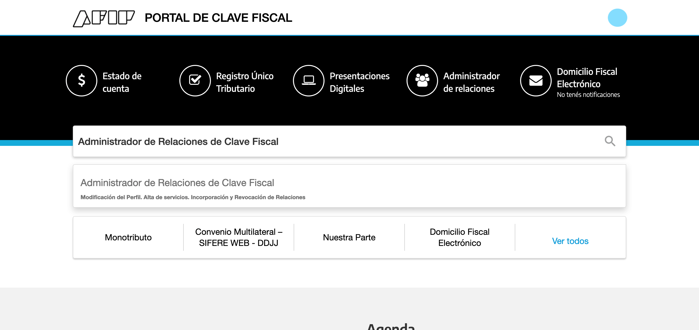

2. Elegí el contribuyente a administrar. En pruebas, usá tu propio usuario para no
   confundirte con datos de otra persona.

   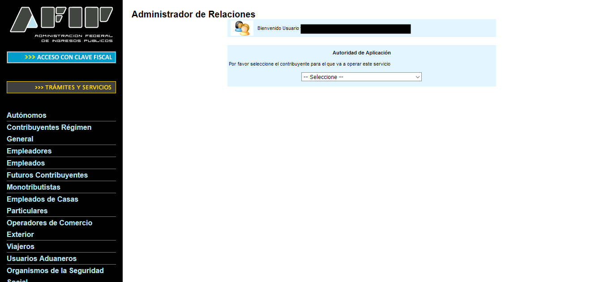

3. Elegí **"Adherir Servicio"**.

   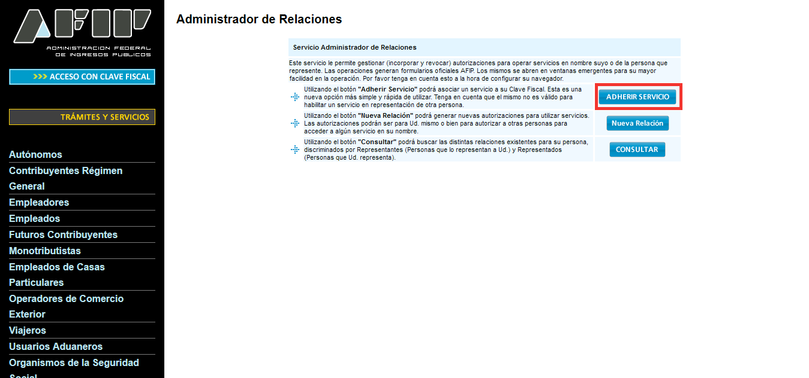

4. Buscá **ARCA → Servicios Interactivos → Administración de Certificados Digitales** en
   la lista y seleccionalo.

   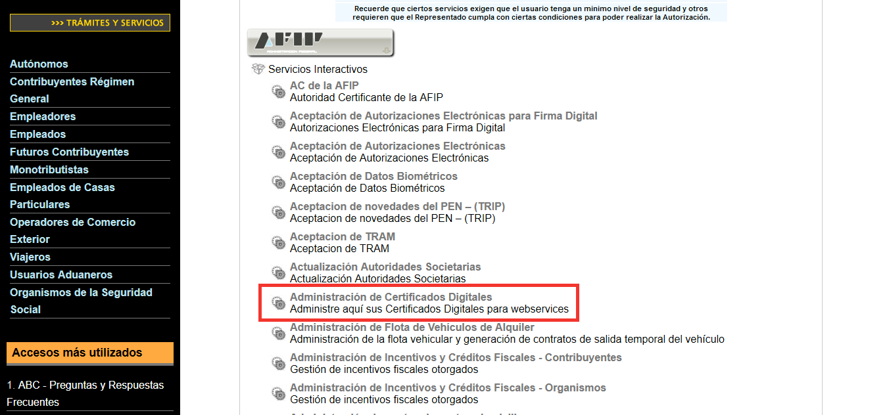

5. Confirmá la relación.

   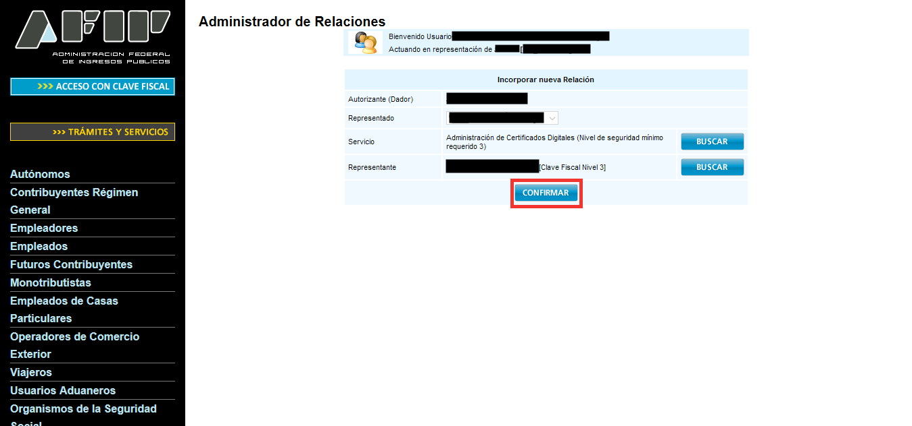

### 2. Generar la clave y el certificado

**Con arcli (recomendado).** Desde el modo interactivo: `arcli` → Configuración → Certificados de ARCA. O por comandos, con el CUIT ya configurado (`arcli config establecer cuit <CUIT>`):

```bash
arcli certificado generar --testing
```

Crea la clave privada y el CSR en la carpeta de config de arcli (no necesitás `openssl`, tampoco en
Windows) y te muestra el CSR para pegar en WSASS. Seguí con "Ahora entrá a WSASS" más abajo y, cuando
tengas el certificado en un archivo, cargalo:

```bash
arcli certificado importar testing.crt
```

`importar` valida el certificado, lo guarda junto a la clave y configura `cert.testing` y `key.testing`:
podés saltear el paso 4. Te dice qué cargó (entorno, CUIT, alias y vencimiento).

**Con openssl.** Generá la clave privada (2048 bits como mínimo) y guardala en un lugar seguro — es la
"contraseña" del certificado, si la perdés tenés que empezar de nuevo:

```bash
openssl genrsa -out testing.key 2048
```

Con esa clave, generá el CSR (Certificate Signing Request). Reemplazá `[empresa]`,
`[nombre]` y `[CUIT]` por tus datos (en pruebas, podés usar los tuyos):

```bash
openssl req -new -key testing.key -subj "/C=AR/O=[empresa]/CN=[nombre]/serialNumber=CUIT [CUIT]" -out testing.csr
```

Ahora entrá a **WSASS - Autoservicio de Acceso a WebServices (Testing/Homologación)**
desde el escritorio de ARCA (llegaste ahí en el paso anterior) y elegí **"Nuevo
Certificado"**:

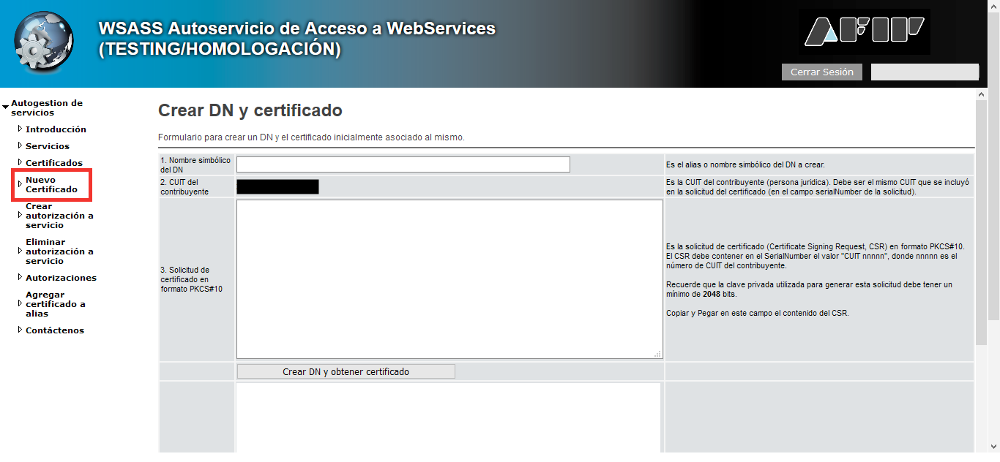

Completá:

1. **Nombre simbólico del DN**: un alias para identificar este certificado (ej. `Test1`).
2. **CUIT del contribuyente**: ya viene completo.
3. **Solicitud de certificado**: pegá el contenido completo de `testing.csr` (abrilo con
   un editor de texto).

Presioná **"Crear DN y obtener certificado"** y copiá el certificado que aparece en el
recuadro de resultado a un archivo (ej. `testing.crt`):

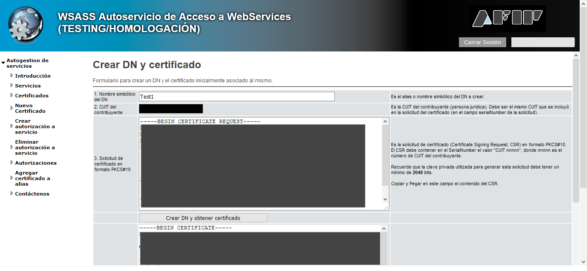

Ya no necesitás el CSR, podés borrarlo. Guardá `testing.key` y `testing.crt` — son los que
vas a usar en arcli.

### 3. Autorizar el servicio web

El certificado por sí solo no alcanza: hay que autorizarlo explícitamente a usar el
servicio web que te interesa (por ejemplo `wsfe`, facturación electrónica). Dentro de
WSASS, elegí **"Crear autorización a servicio"**:

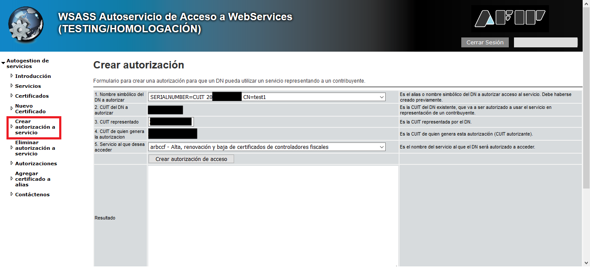

Completá:

1. **Nombre simbólico del DN a autorizar**: el alias que creaste antes (ej. `Test1`).
2. **CUIT representado**: en pruebas, tu propio CUIT.
3. **Servicio al que deseas acceder**: `wsfe` para facturación electrónica.

> Repetí este paso con cada servicio de [Qué servicios autorizar](#qué-servicios-autorizar) que vayas a usar: `ws_sr_constancia_inscripcion`, `wsfecred` o `wsfex`.

Presioná **"Crear autorización de acceso"** — deberías ver un mensaje `OK. Autorización
fue creada`:

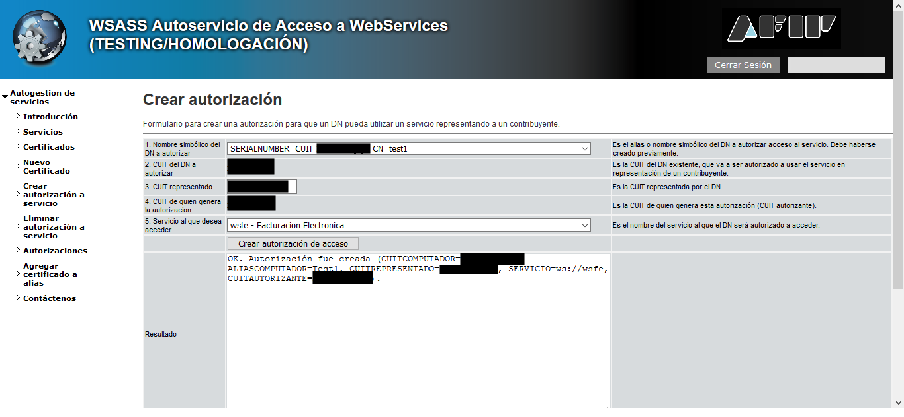

Podés verificarlo entrando a la sección **"Autorizaciones"**:

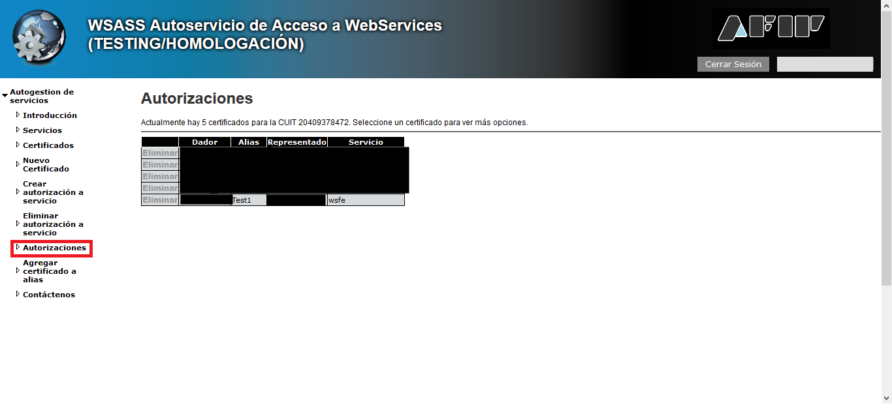

### 4. Configurar arcli

```bash
arcli config establecer cert.testing /ruta/a/testing.crt
arcli config establecer key.testing /ruta/a/testing.key
arcli config revisar
```

---

## Producción

Repetí el mismo flujo, con dos diferencias: la aplicación para generar el certificado no
es WSASS sino **"Administración de Certificados Digitales"**, y la autorización del
servicio web se hace desde el Administrador de Relaciones en vez de WSASS.

### 1. Habilitar el administrador de certificados

Son los mismos 5 pasos que en testing (sección anterior), eligiendo el mismo servicio
**Administración de Certificados Digitales** para tu usuario en producción.

### 2. Generar la clave y obtener el certificado

**Con arcli (recomendado):** `arcli certificado generar --produccion`, subí el CSR como se muestra abajo y,
con el `.crt` descargado, `arcli certificado importar produccion.crt`. Configura `cert.produccion` y
`key.produccion`, así que podés saltear el paso 4.

**Para renovar** un certificado que está por vencer, es el mismo flujo: `generar` deja la clave nueva
pendiente y no toca la actual, así que seguís facturando hasta que `importar` carga el certificado nuevo.
Acordate de volver a crear las relaciones del paso 3 si usás un alias nuevo.

**Con openssl.** Mismos comandos que en testing, con un archivo distinto:

```bash
openssl genrsa -out produccion.key 2048
openssl req -new -key produccion.key -subj "/C=AR/O=[empresa]/CN=[nombre]/serialNumber=CUIT [CUIT]" -out produccion.csr
```

Entrá a **"Administración de Certificados Digitales"** desde el escritorio de ARCA y
elegí **"Agregar alias"**:

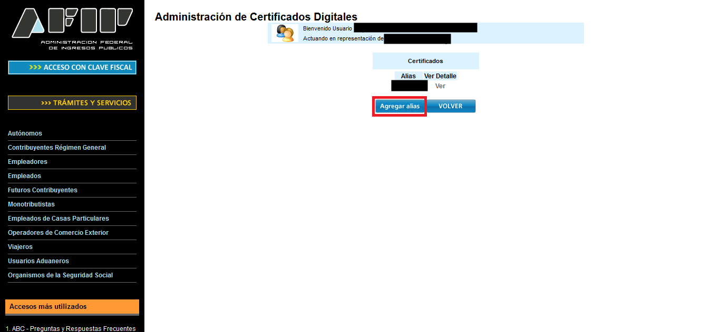

Completá el **Alias** y subí el archivo `produccion.csr` con **"Examinar..."**:

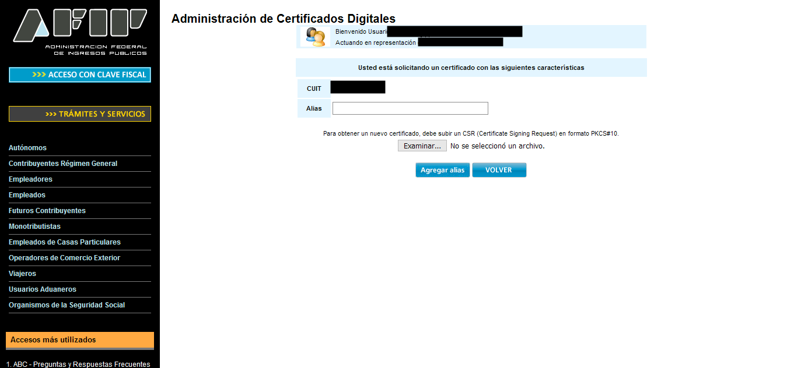

Confirmá con **"Agregar Alias"**. En la lista de certificados, hacé clic en **"Ver"** para
tu alias:

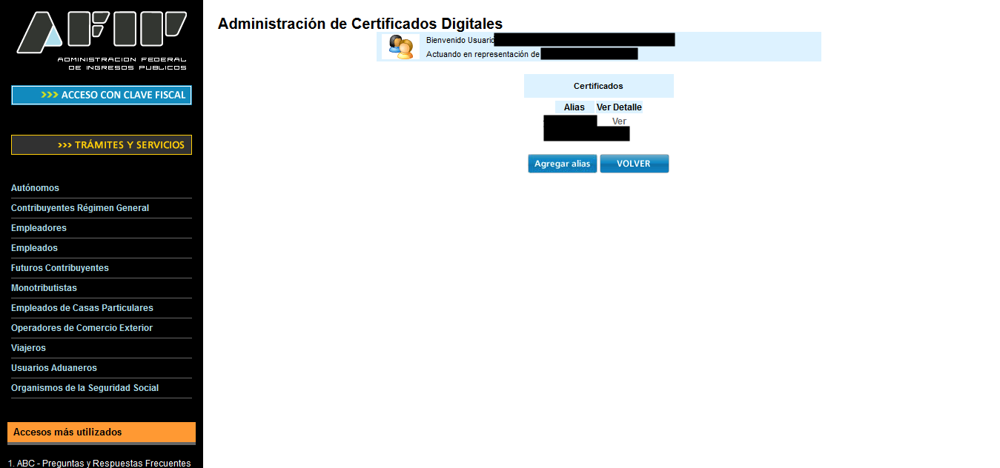

Y descargá el certificado desde el ícono de descarga (columna **Descargar**, estado
`VALIDO`):

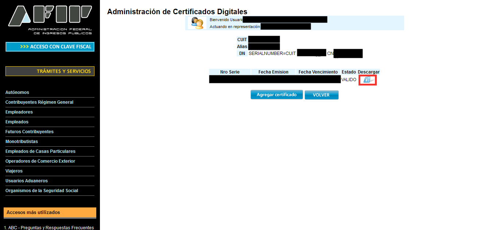

El CSR ya no es necesario después de este paso, podés borrarlo.

### 3. Autorizar el servicio web

En producción esto se hace desde el **Administrador de Relaciones**, no desde WSASS.
Elegí **"Nueva Relación"** y presioná **"Buscar"** junto a Servicio:

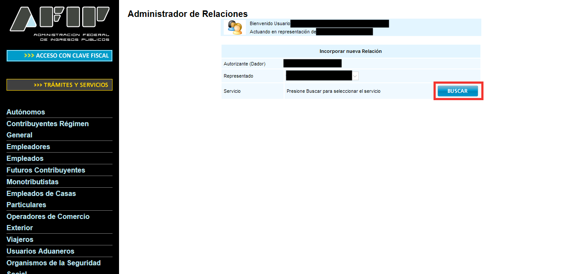

Navegá a **ARCA → Web Services** y elegí el servicio que necesitás (ej. `wsfe`). Creá una relación por cada servicio de [Qué servicios autorizar](#qué-servicios-autorizar) que vayas a usar:

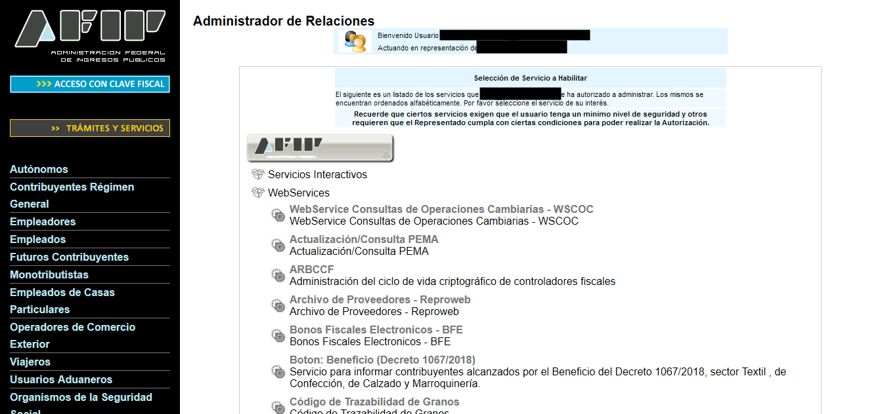

Presioná **"Buscar"** junto a Representante:

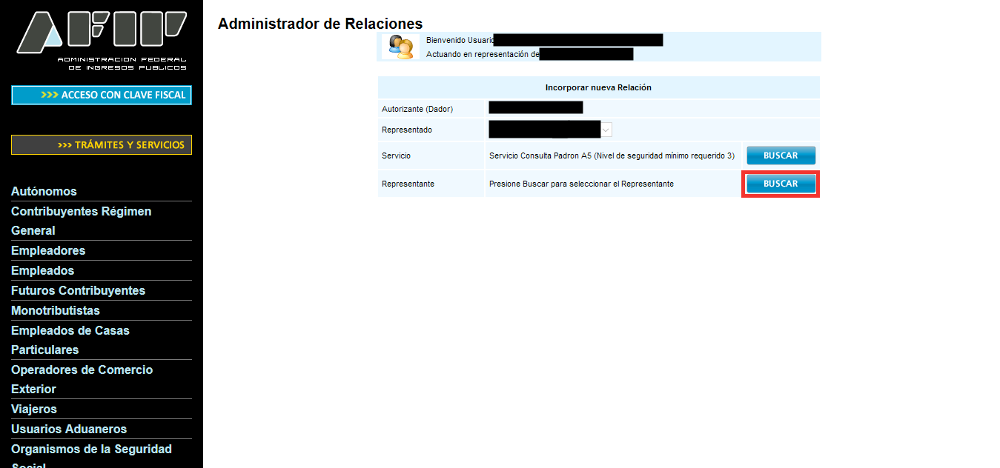

Elegí el **Computador Fiscal** asociado a tu certificado y confirmá:

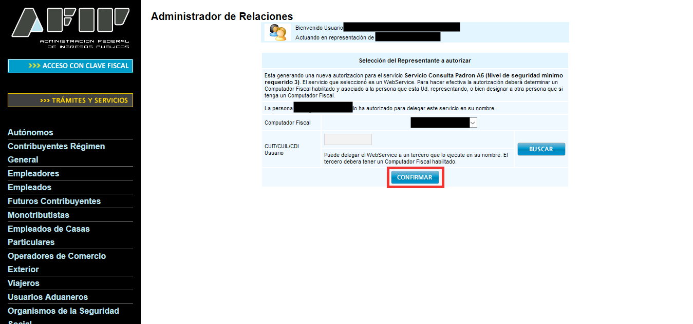

Por último, confirmá la relación completa:

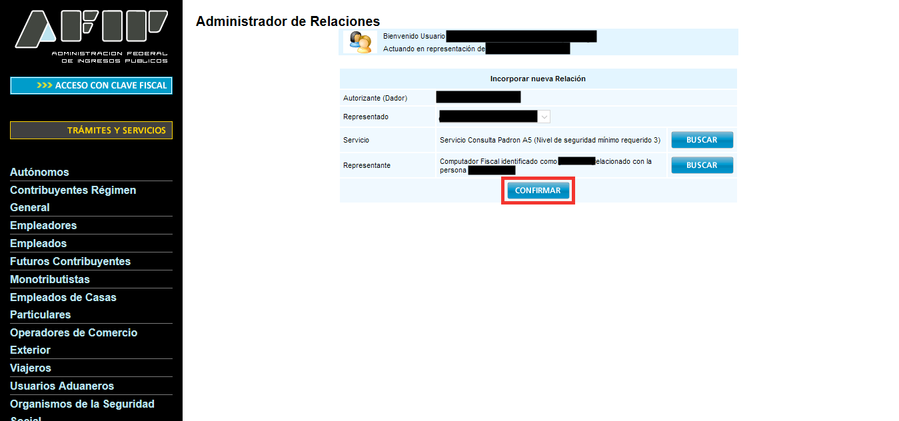

### 4. Configurar arcli

```bash
arcli config establecer cert.produccion /ruta/a/produccion.crt
arcli config establecer key.produccion /ruta/a/produccion.key
arcli config revisar
```

Para emitir de verdad en producción, pasá además `--produccion --emitir` en el
comando de facturación — ver [Testing y producción](../README.md#testing-y-producción).

## Punto de venta para web service

Para emitir en producción también necesitás un punto de venta dado de alta para **web
service**. No sirve cualquiera: ARCA rechaza el comprobante (error `10005`, "El punto de
venta informado debe estar dado de alta y ser del tipo RECE") si el número que configurás
en arcli es de otro sistema, como los de **Comprobantes en línea** ("Factura en línea"),
Facturador o talonarios manuales. Cada sistema usa sus propios puntos de venta: si ya
facturás desde la web de ARCA, creá uno nuevo para arcli.

> **Monotributistas, desde el 1/11/2026:** con la
> [RG 5893/2026](https://www.boletinoficial.gob.ar/detalleAviso/primera/346598/20260831),
> si no tenés un punto de venta electrónico habilitado, ARCA te da de alta uno de oficio
> para **Comprobantes en línea**, con la opción "Factura en línea - Monotributo". Ese
> punto de venta no sirve para arcli: creá otro para web service.

En testing no hace falta: ARCA no controla el punto de venta y cualquier número sirve.

> En producción, la factura de exportación (`arcli fe`) usa **WSFEX - Factura Electrónica de Exportación**, que es un sistema de puntos de venta distinto del de facturación (`wsfe`): un punto de venta habilitado solo para facturación electrónica no sirve para exportación. Dalo de alta con ese sistema si vas a emitir comprobantes `E`.

### 1. Ver si ya tenés uno

Con el certificado de producción configurado:

```bash
arcli parametros puntos-venta --produccion
```

La lista trae solo los puntos de venta habilitados para web service (CAE o CAEA). Si el
tuyo no aparece, o la lista está vacía, seguí con el paso 2. `arcli estado --produccion`
también avisa si el punto de venta configurado no está entre los habilitados.

### 2. Crearlo en ARCA

1. Entrá al portal de ARCA con tu Clave Fiscal y abrí el servicio **"Administración de
   puntos de venta y domicilios"**. Si no lo ves, adherilo desde el Administrador de
   Relaciones, como hiciste con el de certificados.
2. Elegí tu CUIT y entrá a **"A/B/M de puntos de venta"**.
3. Presioná **"Agregar"** (o "Alta") y completá:
   - **Número:** uno que no uses en ningún otro sistema (por ejemplo `2` si el `1` es de
     Comprobantes en línea).
   - **Sistema:** el de web services que corresponde a tu condición. Según la tabla de
     ARCA, **"Factura Electrónica - Monotributo - Webservices"** si sos monotributista, o
     **"Factura Electrónica - RI IVA - Aplicativo y Webservices"** si sos responsable
     inscripto. En algunas pantallas aparece como "RECE para aplicativo y web services".
     No elijas una opción que diga "Comprobantes en Línea" ni "Factuweb".
   - **Domicilio:** el domicilio desde el que facturás.
4. Confirmá.

Después, revisá que aparezca y guardalo en arcli:

```bash
arcli parametros puntos-venta --produccion
arcli config establecer puntoVenta 2
arcli estado --produccion
```

## Siguiente paso

Configurá el CUIT y el punto de venta (en producción, uno [para web service](#punto-de-venta-para-web-service)), o corré `arcli` para la [configuración guiada](../README.md#configuración), y emití tu primera factura en testing.

---

## Fuentes

Tutoriales originales de afipts.com en los que se basa esta guía:

- [Habilitar certificados de testing](https://www.afipts.com/tutorial/enable_testing_certificates.html)
- [Obtener certificado de testing](https://www.afipts.com/tutorial/obtain-testing-certificate.html)
- [Autorizar servicio web de testing](https://www.afipts.com/tutorial/authorize-test-web-service.html)
- [Habilitar administrador de certificados de producción](https://www.afipts.com/tutorial/enable-production-certificate-manager.html)
- [Obtener certificado de producción](https://www.afipts.com/tutorial/obtain-production-certificate.html)
- [Autorizar servicio web de producción](https://www.afipts.com/tutorial/authorize-web-production-service.html)

Punto de venta para web service:

- [Puntos de venta: para qué se utiliza cada sistema](https://www.afip.gob.ar/facturacion/documentos/puntos-de-venta.pdf) (ARCA)
- [Acciones a realizar para consumir un web service de factura electrónica](https://www.afip.gob.ar/fe/documentos/AccionesarealizarparaconsumirunWebservicedeFacturaElectr.pdf) (ARCA)
- [Manual del desarrollador de WSFEv1](https://www.afip.gob.ar/ws/documentacion/manuales/manual-desarrollador-ARCA-COMPG.pdf) (ARCA, error `10005` y `FEParamGetPtosVenta`)
- [RG 5893/2026](https://www.boletinoficial.gob.ar/detalleAviso/primera/346598/20260831) (Boletín Oficial)
