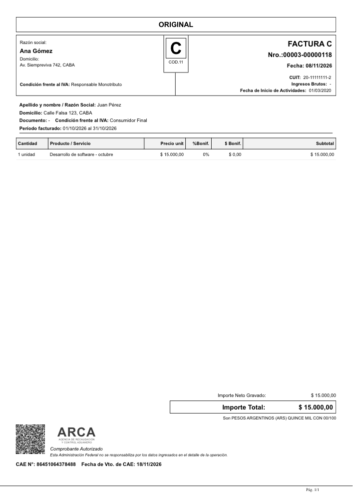

[← Volver a la documentación](README.md)

# PDF de comprobantes

ARCLI arma el PDF de cada comprobante emitido, con el código QR de ARCA y tus datos, y lo guarda en tu computadora.



## Cómo se activa

<!-- arcli: pasos -->

### 1. Instalá el plugin

Una sola vez. Se descarga aparte para que ARCLI siga siendo liviano.

```bash
arcli pdf instalar
```

### 2. Cargá tus datos de emisor

ARCA no los guarda, así que el PDF los toma de tu config.

```bash
arcli config establecer emisor.razonSocial "Tu Nombre o Empresa"
arcli config establecer emisor.domicilio "Calle 123, Ciudad"
arcli config establecer emisor.inicioActividades 1/03/2020
```

### 3. Emití

Al confirmar, elegí **Sí, emitir y generar el PDF**. Con un comando, sumá `--pdf`.

## Cuándo se genera

| `pdf` en la config        | Qué pasa                             |
| ------------------------- | ------------------------------------ |
| `preguntar` (por defecto) | Te lo ofrece al confirmar la emisión |
| `siempre`                 | Lo genera con cada comprobante       |
| `nunca`                   | No lo genera; `--pdf` lo pide igual  |

## Dónde queda

En una carpeta por CUIT, con el tipo y el número en el nombre:

```text
~/arcli/comprobantes/20123456786/factura-c_0003-00000125.pdf
```

Los de testing van dentro de `testing/`, para no mezclarlos con los reales.

> [!NOTE]
> **Si el PDF falla, el comprobante ya está emitido.** El PDF se arma después de que ARCA aprueba: si falla, el comprobante sigue siendo válido y no hay que volver a emitirlo. Qué hacer, en [problemas frecuentes](troubleshooting.md#pdf).

Leyendas obligatorias, datos opcionales, la factura E y la salida en JSON, en la [guía completa del PDF](pdf.md).
